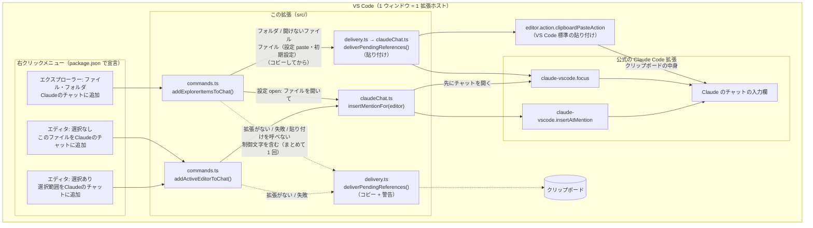
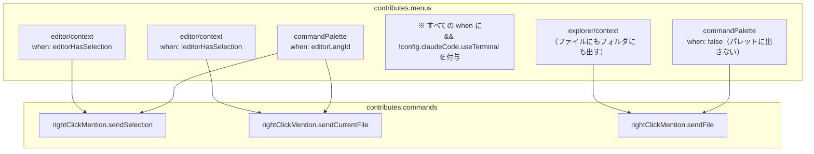
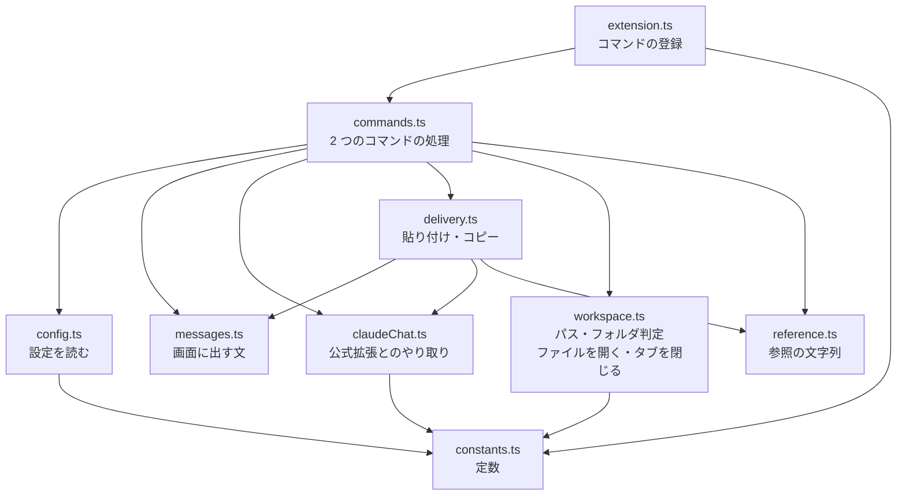
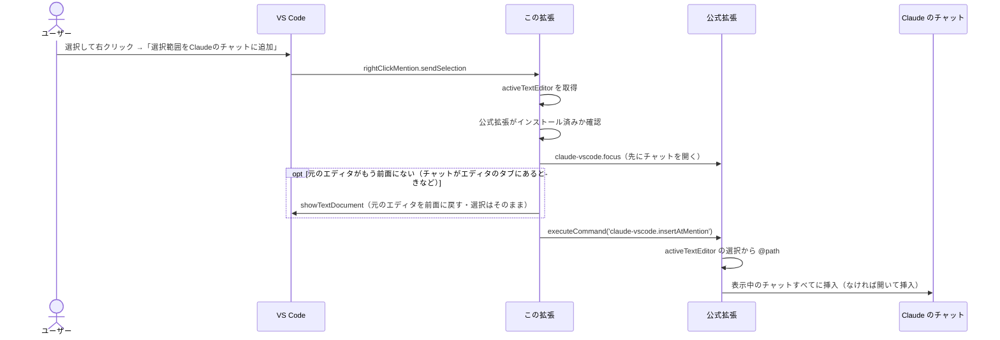
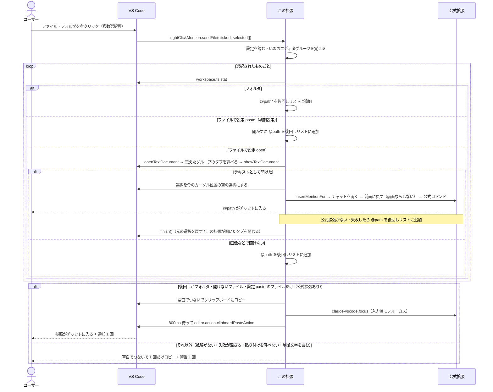
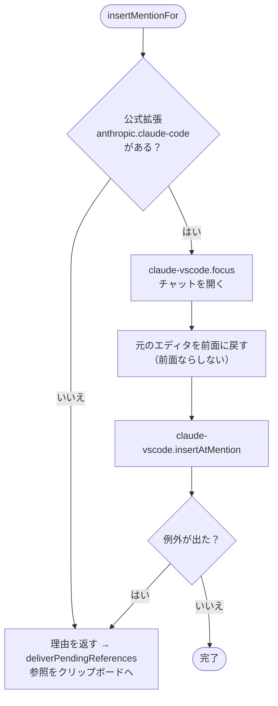
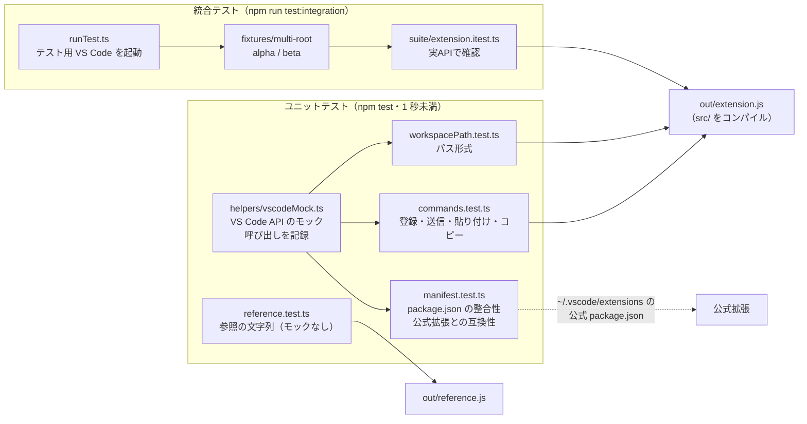

# Right Click Mention — アーキテクチャ

右クリックメニューから、公式の Claude Code 拡張の「Insert @-Mention Reference」（Alt+K）を呼び出すだけの小さな拡張。
自前で Claude と通信はせず、**入口（メニュー）を足して、処理は公式拡張に委ねる**のが基本方針。

- バージョン: 0.0.5
- 対象モード: VS Code の Claude パネル版のみ（`claudeCode.useTerminal` が true のときはメニューを出さない）
- 言語: TypeScript（本体もテストも `src/` に置き、`tsc` で `out/` にコンパイル）
- 対象: VS Code 1.94 以上、公式拡張 `anthropic.claude-code`（v2.1.317 で確認）

---

## 1. 全体構成



**ポイント**

- メニュー項目・表示条件は `package.json` の `contributes.menus` だけで決まる（コードは書いていない）。
- 実際に `@file#5-10` を作ってチャットに入れるのは公式拡張。この拡張はそのコマンドを呼ぶだけ。
- エクスプローラーのファイルは、初期設定（`paste`）では開かずに貼り付けで入れる。設定を `open` にすると、ファイルを一瞬開いて公式コマンドで入れる。
- フォルダとテキストで開けないファイルは、公式コマンドでは扱えない。参照をクリップボードにコピーし、公式の「Focus input」（`claude-vscode.focus`）で入力欄にフォーカスしてから、VS Code 標準の貼り付けを呼ぶ。使うのはどちらも公開されているコマンドだけ。
- 公式拡張が使えないときや貼り付けを呼べないとき、参照に制御文字（改行・見えない書式文字・行区切りなど）が入っているときは、参照をクリップボードにコピーして警告を出す。複数あるときは空白でつないで 1 回だけコピーし、通知・警告も 1 回にまとめる。

---

## 2. ファイル構成

| ファイル | 役割 |
|---|---|
| `package.json` | 拡張のマニフェスト。コマンド 3 つ、右クリックメニュー、設定（`contributes.configuration`）を宣言 |
| `src/` | 本体（→ 4 章）。役目ごとにファイルを分けている |
| `out/` | `src/` のコンパイル結果。`package.json` の `main` はここを指す。git には入れない |
| `tsconfig.json` | TypeScript（7）の設定（`strict` で型を厳しくチェック）。TypeScript 6 以降は `@types/*` が自動で読み込まれないので、`types` に node / mocha / vscode を書いている |
| `.oxlintrc.json` | Oxlint（リンター）の設定（→ 9 章） |
| `.node-version` | 使う Node のバージョン（26）。CI の `setup-node` もここを読む |
| `.vscode/launch.json` / `tasks.json` | `F5` で `out/` を消してからコンパイルし（`npm: build`）、拡張開発ホストを起動する設定 |
| `.vscode/extensions.json` | このフォルダを開くと、Oxlint 拡張（`oxc.oxc-vscode`）を入れるよう案内する |
| `README.md` | 使い方（GitHub のトップに表示される） |
| `docs/ARCHITECTURE.md` | このファイル |
| `docs/MANUAL_TEST.md` | 手動テストの手順（チャットに本当に入るか、Remote で動くか） |
| `LICENSE` | MIT ライセンス |
| `.vscodeignore` | VSIX に入れないファイルの指定（`src/`・`docs/`・`out/test/` など。VSIX に入るのは `out/*.js`・`package.json`・README・CHANGELOG・LICENSE） |
| `.gitignore` | git に入れないファイルの指定（`node_modules/`・`out/`・`*.vsix` など） |
| `.github/workflows/release.yml` | タグを push すると、テスト → VSIX 作成 → Releases に添付（→ 9 章）（手動実行では VSIX を Actions の成果物に置くだけ） |
| `.github/workflows/ci.yml` | PR と main への push で、`npm ci`・リンター（Oxlint）・ユニットテスト・VSIX 作成を確かめる |
| `CHANGELOG.md` | 変更履歴。リリースの説明文はここから作る |
| `.github/dependabot.yml` | Action と devDependencies の更新を PR で知らせる |
| `.gitattributes` | 改行を LF にそろえる |
| `src/test/` | テスト一式（→ 10 章）。`out/test/` にコンパイルされるが、VSIX には含めない |

VSIX はリポジトリに入れない。配るときは `npm run package` で作り、GitHub の Releases に添付する。

---

## 3. package.json（宣言部分）



- `when` 条件で、選択の有無により**どちらか片方だけ**がメニューに出る。
- すべての `when` に `!config.claudeCode.useTerminal` を付けているので、ターミナル版の設定ではメニュー・パレットに出ない（公式拡張のコマンドパレット設定と同じ条件）。
- エディタの 2 つのコマンドは、テキストのファイルが前面にあるときだけコマンドパレットに出す（`editorLangId`）。`editorIsOpen` だと、Claude のチャットをエディタのタブで開いているだけでも出てしまい、押しても「開いているファイルがありません」になるため。
- `sendFile` はエクスプローラーで選んだ URI を引数に受け取る前提なので、コマンドパレットからは隠している。
- `activationEvents` は書いていない。VS Code 1.74 以降はコマンド実行時に自動で有効化される。
- `capabilities.untrustedWorkspaces.supported: false` で、制限モード（信頼していないワークスペース）では動かさない。
- `extensionKind: ["workspace", "ui"]` で、Remote（WSL・SSH など）ではリモート側でも手元の PC 側でも動けると宣言している（→ 8 章）。

---

## 4. src/ の構成

役目ごとにファイルを分けている。状態を持たない処理を順に呼ぶだけなので、クラスは使わず関数で書いている（状態を持つ必要が出たら、その部分だけクラスにする）。



`constants.ts`・`messages.ts`・`reference.ts` は vscode に依存しないので、テストからモックなしで直接読み込める。`extension.ts` が外に出すのは `activate` と `deactivate` だけ。

| ファイル | 中身 |
|---|---|
| `extension.ts` | `activate(context)`: 3 つのコマンドを登録（`sendSelection` と `sendCurrentFile` は同じ処理）。`deactivate()` |
| `commands.ts` | `addActiveEditorToChat()`: エディタの右クリック。公式コマンドで入れ、入れられなければ `deliverPendingReferences` に渡す<br/>`addExplorerItemsToChat(clicked, selected)`: エクスプローラーの右クリック。URI がひとつもなければ「追加するファイルやフォルダがありません」と通知して終わる。設定は最初に 1 回だけ読む。ファイルを開く前に、ユーザーがいま使っているエディタグループ（`viewColumn`）を覚えておく。1 つずつ次のように振り分ける<br/>・フォルダ → `{ ref, reason: 'folder' }` として後回し<br/>・ファイルで設定 `paste`（初期設定） → 開かずに `{ ref, reason: 'pasteFile' }` として後回し<br/>・ファイルで設定 `open` → `addFileByOpening(uri, column)` で入れる。入れられなければ `PendingReference` を返し、後回しにする<br/>最後に、後回しにしたものをまとめて `deliverPendingReferences` に渡す<br/>`addFileByOpening(uri, column)`: `openForMention(uri, column)` で開き、`insertMentionFor(editor)` で入れてから `finish()` を呼ぶ |
| `claudeChat.ts` | `isClaudeInstalled()`<br/>`insertMentionFor(editor)`: 公式拡張がなければ `notInstalled` を返す。あれば、先にチャットを開き（`claude-vscode.focus`）、`bringToFront(editor)` で元のエディタを前面に戻してから、公式コマンド（`claude-vscode.insertAtMention`）を呼ぶ。失敗したら `failed` を返す<br/>`bringToFront(editor)`: そのエディタのドキュメントがまだアクティブなエディタなら何もしない（チャットがサイドバーにあるときは、ふつうこれ）。`viewColumn` がないときや、ノートブックのセルのときも何もしない。それ以外は `showTextDocument(doc, { viewColumn, preserveFocus: false, selection })` で前面に戻す<br/>`pasteClipboardIntoChat()`: `claude-vscode.focus` → `FOCUS_WAIT_MS`（800ms）待つ → 標準の貼り付け |
| `delivery.ts` | `DeliveryReason`（理由の種類: `notInstalled` / `failed` / `notText` / `folder` / `pasteFile`）、`PendingReference`（`{ ref, reason }`）<br/>`deliverPendingReferences(pending)`: 貼り付けるかコピーするかをここだけで決める。次の 3 つがそろえば貼り付け（通知 1 回）。それ以外はコピー（警告 1 回）<br/>・公式拡張がある<br/>・理由がすべて `folder` / `notText` / `pasteFile`<br/>・参照に制御文字・見えない書式文字・行区切り（`\p{Cc}` `\p{Cf}` `\p{Zl}` `\p{Zp}`）が入っていない<br/>公式拡張がなければ、その理由も警告に足す。表示する文は `messages.ts` にある |
| `workspace.ts` | `workspacePath(uri)`: 公式と同じ形式のパス<br/>`isFolder(uri)`: `workspace.fs.stat` で判定（シンボリックリンクのフォルダも含む。調べられなければファイル扱い）<br/>`openForMention(uri, viewColumn?)`: `openTextDocument` で開き、渡されたエディタグループ（ユーザーがもともと使っていたグループ）に表示する。2 つ目以降のファイルが、チャットのグループに開かないようにするため。表示する前に、そのグループにそのドキュメントのタブがあるかを、ドキュメント自身の URI で調べる。プレビューにはしない。公式コマンドを呼ぶ直前に、選択を今のカーソル位置の空の選択にする。`{ editor, finish() }` を返し、開けない・表示できなければ `undefined`<br/>`finish()`: タブを残すときは、そのドキュメントをいま表示しているエディタに元の選択を戻す（エディタが作り直されていることがあるため）。この拡張が開いたタブなら閉じる（`tabGroups` を使う） |
| `reference.ts` | `fileReference(path, selection?)`: `@path` / `@path#8` / `@path#5-10`<br/>`folderReference(path)`: `@path/`<br/>`joinReferences(refs)`: 空白でつなぐ |
| `constants.ts` | `COMMANDS`（この拡張のコマンド ID）、`CLAUDE`（公式拡張の ID とコマンド）、`PASTE_COMMAND`、`FOCUS_WAIT_MS`、`LOG_PREFIX`、`SETTINGS`（設定の名前） |
| `config.ts` | `explorerFileMode()`: 設定 `rightClickMention.explorerFiles` を読む。`paste`（初期設定。エクスプローラーのファイルも開かずに貼り付ける）か `open`（一瞬開いて公式コマンドで入れる）。知らない値は `paste` として扱う |
| `messages.ts` | 画面に出す文。`REASON_MESSAGES`（公式コマンドで入れられなかった理由）と `MESSAGES`（開いているファイルがない、追加するものがない、貼り付けた、コピーした）。貼り付けの通知は参照を並べるが、4 つ以上なら「N 件」と件数だけにする。テストも同じ定数と比べるので、文を変えてもテストを直さなくてよい |

名前に使う動詞の使い分け:

| 動詞 | 意味 | 例 |
| --- | --- | --- |
| add | この拡張のコマンド（ユーザーから見た「チャットに追加」） | `addExplorerItemsToChat` |
| insert | 公式コマンドでチャットに入れる | `insertMentionFor` |
| paste | クリップボードからチャットに貼り付ける | `pasteClipboardIntoChat` |
| deliver | 後回しにした参照を、まとめて貼り付けかコピーで届ける | `deliverPendingReferences` |

`COMMANDS` のキーが `sendXxx` なのは、公開済みのコマンド ID（`rightClickMention.sendSelection` など）に合わせているため。

機能を足すときの置き場所の目安:

- 新しい右クリックメニュー → `package.json` に宣言、`constants.ts` に ID、`commands.ts` に処理、`extension.ts` で登録
- 公式拡張の別のコマンドを使う → `constants.ts` の `CLAUDE` と `claudeChat.ts`
- 参照の形式を変える・増やす → `reference.ts`（テストはモックなしで書ける）
- 画面に出す文を変える → `messages.ts` だけ
- 貼り付けるかコピーするかの条件を変える（自動の貼り付けを切る設定など） → `delivery.ts` の `deliverPendingReferences` だけ
- 設定を足す → `package.json` の `contributes.configuration` に宣言し、`constants.ts` の `SETTINGS` に名前を書き、`config.ts` に読む関数を足す。その関数を呼ぶのは、設定を使う側のファイル
- ファイルを開いて入れる流れ → `commands.ts` の `addFileByOpening` と `workspace.ts` の `openForMention`
- タブを閉じない設定 → `workspace.ts` の `openForMention` の `finish`
- キーボードショートカット → `package.json` の `keybindings` だけ（コード変更なし）

---

## 5. 処理の流れ

### 5-1. エディタで選択して右クリック



### 5-2. エクスプローラーでファイル・フォルダを右クリック



設定 `open` のとき、ファイルを一度エディタで開くのは、公式コマンドが「アクティブなエディタ」からしか参照を作れないため（URI を引数で渡す口がない）。

設定 `open` のとき、開いたタブの扱い:

- 開くのは、ユーザーがもともと使っていたエディタグループ。最初のファイルでチャットを開くと、チャットのグループがアクティブになることがあるので、最初に覚えておいたグループを使う。2 つ目以降のファイルがチャットのグループに開くのを防ぐため。
- `openTextDocument` で開いたあと、表示する前に、そのグループにそのドキュメントのタブがあるかを調べる。比べるのはドキュメント自身の URI なので、Windows でパスの大文字・小文字が違っても正しく判定できる。
- そのグループにタブがなかったときは、この拡張が開いたタブとして、公式コマンドで入れたあと（入れられずコピーに回ったときも）すぐ閉じる。ほかのグループでだけ開いていたファイルも、そのグループに新しいタブができるので、それを閉じる。
- そのグループにもともとタブがあったときは、タブを残す。カーソルの位置や選択範囲も、送ったあとで元に戻す。戻す先は、そのドキュメントをいま表示しているエディタ（前面に戻したときにエディタが作り直されていることがあるため）。
- 表示するときに選択を (0,0) へ動かすことはしない。公式コマンドを呼ぶ直前に、選択を今のカーソル位置の空の選択にする（公式コマンドが選択範囲を参照に含めてしまうため）。
- プレビュー（斜体のタブ）では開かない。プレビューで開くと、ユーザーがプレビューで開いていた別のファイルのタブを置き換えて消してしまうため。プレビューにしなくても、送ったあとで閉じるのでタブは増えない。

### 5-3. 公式コマンドで入れられないときの判断



---

## 6. 参照文字列の形式

公式拡張のコマンド（`Alt+K`）を実際に動かしてチャットに入った文字列と比べ、同じ形式になるようにしている（フォールバックでクリップボードに入れるとき用）。

| 状況 | 例 |
|---|---|
| 選択なし | `@src/app.ts` |
| 1 行 | `@src/app.ts#8` |
| 複数行 | `@src/app.ts#5-10` |
| マルチルート | `@beta/src/app.ts`（先頭にフォルダ名） |
| ワークスペース外 | 絶対パス |
| フォルダ | `@src/components/`（末尾に `/`。貼り付けでチャットに入れる。Claude Code はフォルダの中身の一覧として受け取る） |
| 複数（コピー・貼り付けするとき） | `@src/ @docs/ @logo.png`（空白でつなぐ） |

公式との違い（フォールバック時のみ）: 次の行の先頭で選択が終わっている場合、この拡張は、その行を範囲に含めない。公式は含める。

---

## 7. 設計上の判断

- **公式コマンドに委ねる**: 参照の形式やチャットへの挿入方法を公式と完全に一致させられ、コードも短い。
- **公式拡張のコマンドに依存する**: 公式拡張の更新でコマンド名が変わると動かなくなる。そのときは `src/constants.ts` の `CLAUDE` を書き換える（キーボードショートカット画面で「Insert @-Mention」を検索 → 右クリック →「コマンドIDをコピー」）。
- **失敗しても無駄にしない**: チャットに追加できないときはクリップボードにコピーし、手で貼れるようにしている。
- **先にチャットを開く**: チャットが閉じていたり起動しきっていなかったりすると、公式コマンドは起動を 15 秒待って、参照を入れずに諦める（失敗も返さない）。そこで、公式コマンドの前に `claude-vscode.focus` でチャットを開いて起動させる。チャットをエディタのタブで開いていると、フォーカスが移って「アクティブなエディタ」がなくなるので、元のエディタを `showTextDocument` で前面に戻してから公式コマンドを呼ぶ（選択範囲はそのまま残る）。チャットが開いているかを調べる API はない（サイドバーのチャットはタブの一覧に出ない）ので、毎回開く。
- **前面に戻すのは必要なときだけ**: `bringToFront` は、そのエディタのドキュメントがまだアクティブなエディタなら何もしない。チャットがサイドバーにあるときは、ふつうこれになる。左右に分けたエディタで、わざわざ別のグループに開き直したり、余計なタブを作ったりしないため。`viewColumn` がないエディタや、ノートブックのセルも、`showTextDocument` で正しく戻せないので何もしない。
- **フォルダ（と設定 paste のファイル）は貼り付けで入れる**: エクスプローラーのファイルは、初期設定では開かずに貼り付ける。ファイルを開くとタブが一瞬ちらつく。貼り付けはクリップボードを上書きし、フォーカスが移る時間にも左右される。どちらを取るかを設定 `rightClickMention.explorerFiles` で選べるようにした。公式コマンドはファイルしか扱えないため、公開されている `claude-vscode.focus` と VS Code 標準の貼り付けを組み合わせる。公式拡張の中身は使わない。欠点は、クリップボードの中身を上書きすることと、本当に入ったかを確かめられないこと（通知に「入っていなければ Ctrl+V」と書いている）。フォーカスが移るまでの待ち時間は `FOCUS_WAIT_MS`（800ms）。短いと、移りきる前の場所（エディタなど）に貼り付けてしまうので、待たされても気にならない 1 秒未満でなるべく長くしている（最初は 150ms だった）。テストでは 0 に書き換えて待たない。
- **制御文字を含む参照は貼り付けない**: ファイル名に改行などの制御文字が入っていると、参照は自動で貼り付けず、クリップボードにコピーして警告を出すだけにする。見えない書式文字（`\p{Cf}`）や行区切り（`\p{Zl}` `\p{Zp}`）も同じに扱う。フォーカスがチャットに移らなかったとき、貼り付けがエディタやターミナルに入ってしまうおそれがあり、改行がターミナルに入るとコマンドとして動きかねないため。
- **`@types/node` は Node 20 に固定する**: VS Code 1.94〜1.100 の拡張ホストは Node 20 で動く。テストは Node 26 で動かすが、本体が Node 20 にない API を使わないよう、型は Node 20 に合わせている。

---

## 8. 既知の制約（実験で分かったこと）

| 項目 | 内容 | この拡張で対処できるか |
|---|---|---|
| 送り先 | 表示中の Claude のチャットが複数あるとすべてに入る | できない（公式の動作） |
| 複数ウィンドウ | ウィンドウごとに独立して動く | 対処不要 |
| ターミナル版 | 対象外。`useTerminal` が true のときはメニューを出さない | 対象外（意図的） |
| 同じ名前のフォルダ | マルチルートで同名フォルダがあると参照が区別できない → `.code-workspace` の `"name"` で回避 | ワークスペース側で対処 |
| 設定のスコープ | `claudeCode.*` はすべて window / application / machine スコープ。マルチルートではフォルダの settings.json に書いても効かない | できない（VS Code の仕様） |
| リモート（WSL・SSH・Dev Container） | `extensionKind: ["workspace", "ui"]` で、リモート側でも手元の PC 側でも動けると宣言している。使う API（コマンドの呼び出し・クリップボード・`workspace.fs`・タブ）はどちら側からも使えるので、手元の PC に入れるだけで動く見込み。実機ではまだ確かめている途中 | 宣言で対処（要実機確認） |
| チャットの画面が起動しきっていない | 公式拡張は 15 秒待っても起動しないと、参照を入れずに諦める（公式拡張のログに警告が出る）。コマンドは失敗を返さないので、この拡張からは分からない | できない（README の注意に書いている） |
| コマンドパレットの表示条件 | エディタの 2 つのコマンドは `editorLangId` で出し分けている。フォーカスがエクスプローラーやターミナルにあると、ファイルを開いていてもパレットに出ない。出力パネルにフォーカスがあると出ることがある | 仕様として受け入れる |
| Dependabot の待ち期間 | `cooldown` は依存ごとに数えるので、TypeScript と `oxlint-tsgolint` が別々の PR で届くことがある。片方だけ上がると CI が落ちることがある | CI が落ちたら次の更新を待つ／手で揃える |

---

## 9. 開発・ビルド

```bash
# 動作確認（このフォルダを VS Code で開いて）
F5   # npm run build（out/ を消してからコンパイル）をしてから拡張開発ホストが起動する（.vscode/launch.json）

# コンパイル
npm run compile   # src/ → out/
npm run watch     # 保存のたびにコンパイル

# リンター（Oxlint）
npm run lint      # await 忘れなどを調べる（CI でも実行する）

# パッケージ化
npm run package   # = vsce package。直前に vscode:prepublish でコンパイルされる

# 更新するときは package.json の version を上げてから再パッケージ → VSIX から再インストール
```

配布用の VSIX は GitHub Actions（`.github/workflows/release.yml`）が作る。`v*` のタグを push すると、`package` ジョブ（読み取り権限のみ）がリンター・テスト・VSIX 作成を行い、`release` ジョブ（書き込み権限あり・依存は入れない）が Releases に添付する。リリースの説明文は `CHANGELOG.md` の該当バージョンの項目から作る（項目がないときや、中身が空白だけのときは失敗する）。`release` ジョブはタグの push のとき（`github.event_name == 'push'`）だけ動く。手動実行では、タグを選んでも Releases は作らず、VSIX を Actions の成果物に置くだけ。手順は README の「リリースの手順」を参照。リリースの前に、[手動テストの手順](MANUAL_TEST.md) で、チャットに本当に入るかを確かめる。

PR と main への push では `.github/workflows/ci.yml` が `npm ci`・リンター（Oxlint）・ユニットテスト・VSIX 作成を確かめる。Dependabot の PR もここで確かめられるので、壊れる更新は取り込む前に気づける（TypeScript 7 への更新で `npm ci` が失敗したことがきっかけ）。

リンター（Oxlint、`.oxlintrc.json`）:

- TypeScript 7 に対応したリンターとして Oxlint を使う。型情報を使うルールは `oxlint-tsgolint`（TypeScript 7 の Go 版の上で動く）が担当する。
  - 以前は ESLint ＋ typescript-eslint を使っていたが、typescript-eslint が TypeScript 7 に対応していない（7 には JS から使う API がまだない）ため入れ替えた。
  - `oxlint-tsgolint` は決まった TypeScript のバージョンに合わせて作られているので、TypeScript を上げるときは一緒に上げる。Dependabot は devDependencies を 1 つの PR にまとめるが、待ち期間（`cooldown`）は依存ごとに数えるので、別々の PR で届くことがある（→ 8 章）。
- プラグインは指定せず、既定のもの（unicorn・typescript・oxc）を使う。
- import には `node:` を付ける（unicorn の `prefer-node-protocol`）。
- `npm run lint` は `--report-unused-disable-directives` 付きで動かし、いらなくなったルールの無効化コメントも見つける。
- ルールは、まず間違いを見つける `correctness` の一式と、`await` 忘れを見つける `typescript/no-floating-promises`、Promise を渡してはいけない場所に渡していないかを見る `typescript/no-misused-promises` だけにして、増やしすぎない。
- `no-floating-promises` には `checkThenables: true` を付けている。VS Code の API は `Promise` ではなく `Thenable` を返すので、付けないと見逃す（付けない状態で見逃すことを確かめた）。わざと待たない通知には `void` を付ける。
- `node:test` の `describe` / `it` は Promise を返すが待たなくてよいので、このルールの対象から外している。
- `release.yml` の `package` ジョブと `ci.yml` で、テストの前に `npm run lint` を実行する。

安全のための設定:

- Node は最新の LTS（26）を使う。バージョンは `.node-version` の 1 か所に書き、CI もそこを読む。
- `package` ジョブは `npm ci --ignore-scripts` で、依存パッケージのインストールスクリプトを動かさない。checkout の認証情報も残さない（`persist-credentials: false`）。
- 外部の Action はコミットの SHA で固定している。
- vsce は `npx --no-install vsce` で呼び、`package.json` で固定したもの以外をダウンロードして動かさない。
- `release` ジョブは、VSIX に出どころの証明（`actions/attest-build-provenance`）を付ける。`gh attestation verify <vsix> -R kip2/right-click-mention` で確かめられる。
- どちらのワークフローにも `concurrency`（同じものが重なって動かないようにする）と `timeout-minutes`（止まったままにしない）を付けている。`ci.yml` で、動いている途中のものを止めて新しいほうを動かすのは PR のときだけ。main への push では止めない。
- `.github/dependabot.yml` で、Action と npm の devDependencies の更新を月 1 回 PR にする（`@types/vscode` は `engines.vscode` に合わせて手で上げる）。どちらも `cooldown` で、新しいバージョンが出てから 7 日たつまで提案しない（出た直後に乗っ取られたパッケージをすぐ取り込まないため）。

---

## 10. テスト



### 構成

| ファイル | 内容 | 件数 |
|---|---|---|
| `src/test/helpers/vscodeMock.ts` | VS Code API のモック。`asRelativePath` のマルチルート挙動、`Selection` の正規化、バイナリで開けないファイルなどを再現。`setup()` でモック＋拡張＋activate を一度に用意（`out/` のファイルは毎回読み込み直す） | — |
| `src/test/unit/reference.test.ts` | 行番号（1 行・複数行・次行先頭で終わる・逆方向選択）、フォルダの `/`、空白でつなぐ。`reference.ts` をモックなしで直接 import する | 12 |
| `src/test/unit/workspacePath.test.ts` | パス形式（単一・マルチルート・別の場所・入れ子・ワークスペース外）。コマンドを実行し、コピーされた参照で確かめる | 6 |
| `src/test/unit/commands.test.ts` | コマンド登録と dispose、`extension.ts` が activate / deactivate だけを出すこと、送信の分岐（成功・拡張なし・例外・reject）、エクスプローラー（単一・複数・空・引数なし・バイナリ混在・フォルダの貼り付け・貼り付け失敗・拡張なし・ファイルとフォルダの混在・コピーと警告を 1 回にまとめる・同じ理由を 1 回だけ書く）、失敗の経路（フォーカス後の貼り付け失敗・フォルダか調べられない・エディタで表示できない・シンボリックリンクのフォルダ）、開いたタブを閉じる（入れたあとで閉じる・もともと開いていたものは残す・コピーに回っても閉じる・閉じられなくても続ける・フォーカスを保つ・別のグループにだけあったもの・パスの大文字小文字の違い・選択とカーソルを戻す・フォルダなどは触らない・エディタの右クリックでは閉じない）、改行を含む参照は貼り付けない、貼り付け前の待ち時間が 1 秒未満、チャットを先に開いて元のエディタを前面に戻す（チャットがエディタのタブにある場合も）、設定の貼り付け（初期設定）でファイルを開かずに貼り付ける・知らない値は貼り付け扱い・貼り付けの失敗・拡張なし・改行を含む名前・エディタの右クリックには関係しない、前面に戻す処理（まだ前面なら戻さない・選択ごと元のグループへ・失敗しても続ける・ノートブックとグループ不明は戻さない）、送るものがないときの通知、貼り付けの通知の件数、見えない文字、設定 open で元のグループに開く、設定を 1 回だけ読む | 70 |
| `src/test/unit/manifest.test.ts` | package.json の基本項目と category、宣言とコード（`COMMANDS`）の一致、メニューの `when` 条件、制限モードの宣言、Remote の宣言（extensionKind）、公式拡張にコマンドが存在するか、設定の宣言（名前・選べる値・初期設定・見出し） | 21 |
| `src/test/integration/runTest.ts` | `@vscode/test-electron` でテスト用 VS Code を起動（他の拡張は無効） | — |
| `src/test/integration/suite/extension.itest.ts` | 実 VS Code 上でマルチルートのパス、選択の扱い、エクスプローラー送信、開いたタブを閉じる・もともと開いていたタブを残す・選択範囲を元に戻す・プレビューのタブを消さない、バイナリファイル、フォルダの判定、ファイルとフォルダの混在、設定 open と初期設定（貼り付け）の両方 | 21 |
| `src/test/fixtures/multi-root/` | 統合テスト用ワークスペース（同名の `app.js` を持つ alpha / beta、バイナリファイル） | — |

### 実行方法

```bash
npm install                 # 初回のみ（TypeScript とテスト用の依存を入れる）
npm test                    # コンパイル → ユニットテスト
npm run test:spec           # コンパイル → ユニットテスト（結果を一覧表示）
npm run test:integration    # コンパイル → 統合テスト（初回はテスト用 VS Code をダウンロード）
```

### ポイント

- **テストも TypeScript**: `src/test/` に置き、本体と一緒に `out/test/` にコンパイルする（公式の雛形と同じ形）。`reference.ts`・`constants.ts`・`messages.ts` は直接 import し、`extension.ts` はモックを差し込んでから読み込む（型だけは `typeof import('../../extension')` で使う）。テストのためだけの公開（以前の `_internal`）はない。
- **`npm test` の流れ**: `out/` を消してからコンパイルし（`npm run build`。消したファイルが `out/` に残って動き続けるのを防ぐ）、`node --test "out/test/unit/**/*.test.js"` で実行する。ファイルの探し方を Node に任せる（Node 21 以上の機能）。ユニットテストは Node 標準の `node:test`、統合テストは VS Code の中で `mocha` を使う。
- **公式拡張の更新を検知**: `manifest.test.ts` は `~/.vscode/extensions/anthropic.claude-code-*` の package.json を読み、呼んでいる `claude-vscode.insertAtMention` と `claude-vscode.focus` がまだ存在するかを確認する。公式拡張を更新したあとに `npm test` を流せば、コマンド名の変更に気づける。見つからない環境ではスキップ（`CLAUDE_EXT_DIR` で場所を指定可能）。
- **統合テストは公式拡張なし**: テスト用 VS Code では他の拡張を無効にするため、送信結果はクリップボードで確認する（フォールバック経路）。公式拡張のチャットの入力欄に入るところは自動テストできないので、手動で確認する。
- **テストの効き目を確認済み**: わざとバグを入れて（行番号の 0 始まり、コマンド ID 誤り、例外の握りつぶし、選択リセット削除、複数選択の無視、フォルダ名の欠落、メニュー条件の欠落 など 9 種類）すべて検出できることを確認した。ファイルを分けたあとにも、8 種類（行番号の 0 始まり、行末まで選んだときの行、フォルダの判定、フォルダの貼り付け、参照のつなぎ方、公式コマンドの失敗の握りつぶし、エクスプローラーでの失敗の無視、選択のリセット）で同じことを確かめた。

