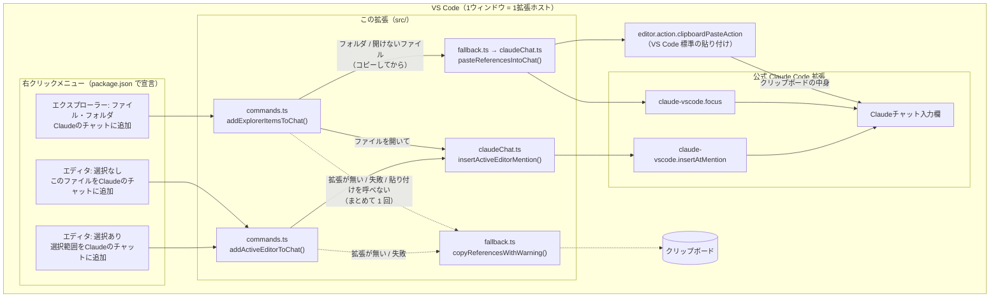
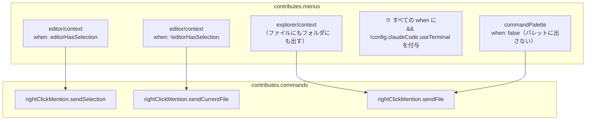
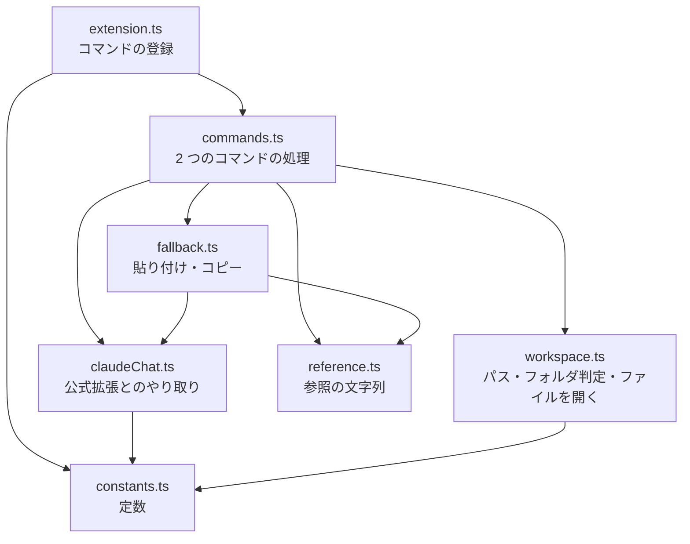
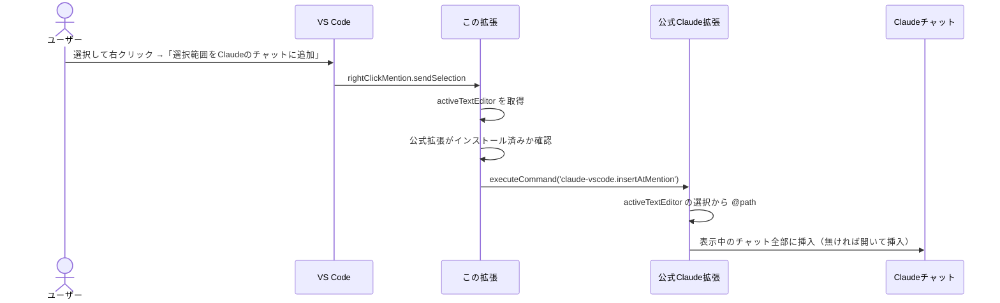
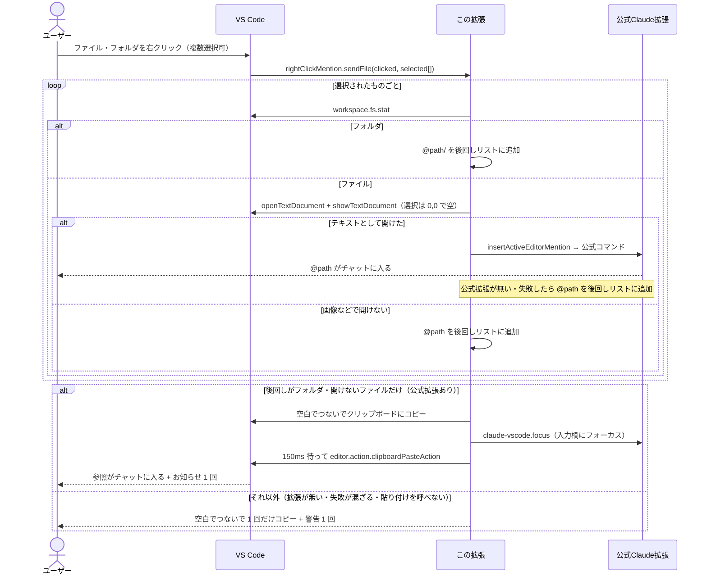
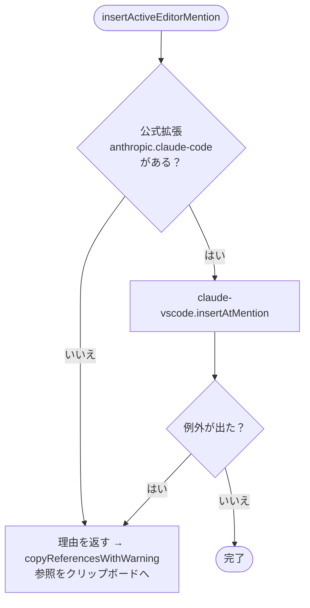
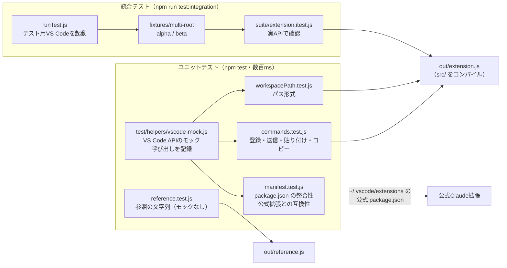

# Right Click Mention — アーキテクチャ

右クリックメニューから、公式 Claude Code 拡張の「Insert @-Mention Reference」（Alt+K）を呼び出すだけの薄いラッパー拡張。
自前でClaudeと通信はせず、**入口（メニュー）を足して、処理は公式拡張に委ねる**のが基本方針。

- バージョン: 0.0.2
- 対象モード: VS Code のClaudeパネル版のみ（`claudeCode.useTerminal` が true のときはメニューを出さない）
- 言語: TypeScript（`src/` を `tsc` で `out/` にコンパイル。テストは JavaScript のまま `out/` を読む）
- 対象: VS Code 1.94 以上、公式拡張 `anthropic.claude-code`（v2.1.317 で確認）

---

## 1. 全体構成



**ポイント**

- メニュー項目・表示条件は `package.json` の `contributes.menus` だけで決まる（コードは書いていない）。
- 実際に `@file#5-10` を作ってチャットに入れるのは公式拡張。この拡張はそのコマンドを呼ぶだけ。
- フォルダとテキストで開けないファイルは、公式コマンドでは扱えない。参照をクリップボードにコピーし、公式の「Focus input」（`claude-vscode.focus`）で入力欄にフォーカスしてから、VS Code 標準の貼り付けを呼ぶ。使うのはどちらも公開されているコマンドだけ。
- 公式拡張が使えないときや貼り付けを呼べないときは、参照をクリップボードに入れて警告を出す。複数あるときは空白でつないで 1 回だけコピーし、お知らせ・警告も 1 回にまとめる。

---

## 2. ファイル構成

| ファイル | 役割 |
|---|---|
| `package.json` | 拡張のマニフェスト。コマンド3つと右クリックメニューを宣言 |
| `src/` | 本体（→ 4章）。役目ごとにファイルを分けている |
| `out/` | `src/` のコンパイル結果。`package.json` の `main` はここを指す。git には入れない |
| `tsconfig.json` | TypeScript の設定（`strict` で型を厳しくチェック） |
| `.vscode/launch.json` / `tasks.json` | `F5` でコンパイルしてから拡張開発ホストを起動する設定 |
| `README.md` | 使い方（GitHub のトップに表示される） |
| `docs/ARCHITECTURE.md` | このファイル |
| `LICENSE` | MIT ライセンス |
| `.vscodeignore` | vsix に入れないファイルの指定（`src/`・`docs/`・`test/` など。vsix に入るのは `out/*.js`・`package.json`・README・LICENSE） |
| `.gitignore` | git に入れないファイルの指定（`node_modules/`・`out/`・`*.vsix` など） |
| `.github/workflows/release.yml` | タグを push すると、テスト → vsix 作成 → Releases に添付（→ 9章） |
| `.github/dependabot.yml` | Action と devDependencies の更新を PR で知らせる |
| `.gitattributes` | 改行を LF にそろえる |
| `test/` | テスト一式（→ 10章）。vsix には含めない |

vsix はリポジトリに入れない。配るときは `npm run package` で作り、GitHub の Releases に添付する。

---

## 3. package.json（宣言部分）



- `when` 条件で、選択の有無により**どちらか片方だけ**がメニューに出る。
- すべての `when` に `!config.claudeCode.useTerminal` を付けているので、ターミナル版の設定ではメニュー・パレットに出ない（公式拡張のコマンドパレット設定と同じ条件）。
- `sendFile` はエクスプローラーで選んだURIを引数に受け取る前提なので、コマンドパレットからは隠している。
- `activationEvents` は書いていない。VS Code 1.74 以降はコマンド実行時に自動で有効化される。
- `capabilities.untrustedWorkspaces.supported: false` で、制限モード（信頼していないワークスペース）では動かさない。

---

## 4. src/ の構成

役目ごとにファイルを分けている。状態を持たない処理を順に呼ぶだけなので、クラスは使わず関数で書いている（状態を持つ必要が出たら、その部分だけクラスにする）。



`constants.ts` と `reference.ts` は vscode に依存しないので、テストからモックなしで直接読み込める。`extension.ts` が外に出すのは `activate` と `deactivate` だけ。

| ファイル | 中身 |
|---|---|
| `extension.ts` | `activate(context)`: 3 つのコマンドを登録（`sendSelection` と `sendCurrentFile` は同じ処理）。`deactivate()` |
| `commands.ts` | `addActiveEditorToChat()`: エディタの右クリック。公式コマンドで入れ、入れられなければコピー<br/>`addExplorerItemsToChat(clicked, selected)`: エクスプローラーの右クリック。ファイルは開いて公式コマンドで入れる。入れられなかったもの（フォルダ・開けないファイル・失敗）は理由と一緒に後回しにし、最後にまとめて貼り付けかコピー |
| `claudeChat.ts` | `isClaudeInstalled()`<br/>`insertActiveEditorMention()`: 公式コマンドを呼ぶ。入れられなかった理由（`notInstalled` / `failed`）を返す<br/>`pasteClipboardIntoChat()`: `claude-vscode.focus` → 少し待つ → 標準の貼り付け |
| `fallback.ts` | `FallbackReason`（理由の種類）と、その表示文<br/>`canPaste(reason)`: 貼り付けで入れられる理由か（フォルダ・開けないファイル）<br/>`pasteReferencesIntoChat(refs)`: コピーして貼り付け、お知らせ 1 回<br/>`copyReferencesWithWarning(refs, reasons)`: コピーして、理由をまとめた警告 1 回 |
| `workspace.ts` | `workspacePath(uri)`: 公式と同じ形式のパス<br/>`isFolder(uri)`: `workspace.fs.stat` で判定<br/>`openAsActiveEditor(uri)`: 選択なしで開いてアクティブにする。開けなければ `undefined` |
| `reference.ts` | `fileReference(path, selection?)`: `@path` / `@path#8` / `@path#5-10`<br/>`folderReference(path)`: `@path/`<br/>`joinReferences(refs)`: 空白でつなぐ |
| `constants.ts` | `COMMANDS`（この拡張のコマンド ID）、`CLAUDE`（公式拡張の ID とコマンド）、`PASTE_COMMAND`、`FOCUS_WAIT_MS`、`LOG_PREFIX` |

機能を足すときの置き場所の目安:

- 新しい右クリックメニュー → `package.json` に宣言、`constants.ts` に ID、`commands.ts` に処理、`extension.ts` で登録
- 公式拡張の別のコマンドを使う → `constants.ts` の `CLAUDE` と `claudeChat.ts`
- 参照の形式を変える・増やす → `reference.ts`（テストはモックなしで書ける）

---

## 5. 処理の流れ

### 5-1. エディタで選択して右クリック



### 5-2. エクスプローラーでファイル・フォルダを右クリック



ファイルを一度エディタで開くのは、公式コマンドが「アクティブなエディタ」からしか参照を作れないため（URIを引数で渡す口がない）。

### 5-3. フォールバックの判断



---

## 6. 参照文字列の形式

公式拡張のコマンド（`Alt+K`）を実際に動かしてチャットに入った文字列と比べ、同じ形式になるようにしている（フォールバックでクリップボードに入れるとき用）。

| 状況 | 例 |
|---|---|
| 選択なし | `@src/app.ts` |
| 1行 | `@src/app.ts#8` |
| 複数行 | `@src/app.ts#5-10` |
| マルチルート | `@beta/src/app.ts`（先頭にフォルダ名） |
| ワークスペース外 | 絶対パス |
| フォルダ | `@src/components/`（末尾に `/`。貼り付けでチャットに入れる。Claude Code はフォルダの中身の一覧として受け取る） |
| 複数（コピー・貼り付けするとき） | `@src/ @docs/ @logo.png`（空白でつなぐ） |

公式との違い（フォールバック時のみ）: 次の行の先頭で選択が終わっている場合、この拡張は最終行を1行減らす（公式は減らさない）。

---

## 7. 設計上の判断

- **公式コマンドに委ねる**: 参照の形式やチャットへの挿入方法を公式と完全に一致させられ、コードも短い。
- **公式拡張のコマンドに依存する**: 公式拡張の更新でコマンド名が変わると動かなくなる。その場合は `src/constants.ts` の `CLAUDE` を書き換える（キーボードショートカット画面で「Insert @-Mention」を検索 → 右クリック →「コマンドIDをコピー」）。
- **失敗しても無駄にしない**: 送れない時はクリップボードにコピーし、手で貼れるようにしている。
- **フォルダは貼り付けで入れる**: 公式コマンドはファイルしか扱えないため、公開されている `claude-vscode.focus` と VS Code 標準の貼り付けを組み合わせる。公式拡張の中身は使わない。欠点は、クリップボードの中身を上書きすることと、本当に入ったかを確かめられないこと（お知らせに「入っていなければ Ctrl+V」と書いている）。フォーカスが移るまでの待ち時間は `FOCUS_WAIT_MS`（150ms）。手動で動くことを確認した。

---

## 8. 既知の制約（実験で分かったこと）

| 項目 | 内容 | この拡張で対処できるか |
|---|---|---|
| 送り先 | 表示中のClaudeチャットが複数あると全部に入る | できない（公式の動作） |
| 複数ウィンドウ | ウィンドウごとに独立して動く | 対処不要 |
| ターミナル版 | 対象外。`useTerminal` が true の時はメニューを出さない | 対象外（意図的） |
| 同じ名前のフォルダ | マルチルートで同名フォルダがあると参照が区別できない → `.code-workspace` の `"name"` で回避 | ワークスペース側で対処 |
| 設定のスコープ | `claudeCode.*` は全て window / application / machine スコープ。マルチルートではフォルダの settings.json に書いても効かない | できない（VS Code の仕様） |
| リモート（WSL/SSH） | リモート側にも拡張のインストールが必要な場合がある | インストールで対処 |

---

## 9. 開発・ビルド

```bash
# 動作確認（このフォルダを VS Code で開いて）
F5   # npm run compile をしてから拡張開発ホストが起動する（.vscode/launch.json）

# コンパイル
npm run compile   # src/ → out/
npm run watch     # 保存のたびにコンパイル

# パッケージ化
npm run package   # = vsce package。直前に vscode:prepublish でコンパイルされる

# 更新時は package.json の version を上げてから再パッケージ → VSIX から再インストール
```

配布用の VSIX は GitHub Actions（`.github/workflows/release.yml`）が作る。`v*` のタグを push すると、`package` ジョブ（読み取り権限のみ）がテストと VSIX 作成を行い、`release` ジョブ（書き込み権限あり・依存は入れない）が Releases に添付する。手順は README の「リリースの手順」を参照。

安全のための設定:

- `package` ジョブは `npm ci --ignore-scripts` で、依存パッケージのインストールスクリプトを動かさない。checkout の認証情報も残さない（`persist-credentials: false`）。
- 外部の Action はコミットの SHA で固定している。
- `release` ジョブは、vsix に出どころの証明（`actions/attest-build-provenance`）を付ける。`gh attestation verify <vsix> -R kip2/right-click-mention` で確かめられる。
- `.github/dependabot.yml` で、Action と npm の devDependencies の更新を月 1 回 PR にする（`@types/vscode` は `engines.vscode` に合わせて手で上げる）。

---

## 10. テスト



### 構成

| ファイル | 内容 | 件数 |
|---|---|---|
| `test/helpers/vscode-mock.js` | VS Code API のモック。`asRelativePath` のマルチルート挙動、`Selection` の正規化、バイナリで開けないファイルなどを再現。`setup()` でモック＋拡張＋activate を一度に用意（`out/` のファイルは毎回読み込み直す） | — |
| `test/unit/reference.test.js` | 行番号（1行・複数行・次行先頭で終わる・逆方向選択）、フォルダの `/`、空白でつなぐ。`out/reference.js` をモックなしで直接読む | 12 |
| `test/unit/workspacePath.test.js` | パス形式（単一・マルチルート・別の場所・入れ子・ワークスペース外）。コマンドを実行し、コピーされた参照で確かめる | 6 |
| `test/unit/commands.test.js` | コマンド登録と dispose、`extension.js` が activate / deactivate だけを出すこと、送信の分岐（成功・拡張なし・例外・reject）、エクスプローラー（単一・複数・空・引数なし・バイナリ混在・フォルダの貼り付け・貼り付け失敗・拡張なし・ファイルとフォルダの混在・コピーと警告を 1 回にまとめる） | 28 |
| `test/unit/manifest.test.js` | package.json の基本項目と category、宣言とコード（`COMMANDS`）の一致、メニューの `when` 条件、制限モードの宣言、公式拡張にコマンドが存在するか | 17 |
| `test/run-unit.js` | ユニットテストの実行スクリプト（Windows / 古いNodeでも動くようにファイルを列挙） | — |
| `test/integration/runTest.js` | `@vscode/test-electron` でテスト用VS Codeを起動（他の拡張は無効） | — |
| `test/integration/suite/extension.itest.js` | 実VS Code上でマルチルートのパス、選択の扱い、エクスプローラー送信、バイナリファイル、フォルダの判定、ファイルとフォルダの混在 | 16 |
| `test/fixtures/multi-root/` | 統合テスト用ワークスペース（同名の `app.js` を持つ alpha / beta、バイナリファイル） | — |

### 実行方法

```bash
npm install                 # 初回のみ（TypeScript とテスト用の依存を入れる）
npm test                    # コンパイル → ユニットテスト
npm run test:spec           # コンパイル → ユニットテスト（結果を一覧表示）
npm run test:integration    # コンパイル → 統合テスト（初回はテスト用VS Codeをダウンロード）
```

### ポイント

- **テストは JavaScript のまま**: テストはコンパイル後の `out/` を読む（`extension.js` はモック経由、`reference.js`・`constants.js` は直接）。テストのためだけの公開（以前の `_internal`）はない。そのため `npm test` などは、先に `npm run compile` を自動で実行する（`pretest`）。ユニットテスト自体は Node 標準の `node:test` を使い、テスト用のライブラリは要らない。
- **公式拡張の更新を検知**: `manifest.test.js` は `~/.vscode/extensions/anthropic.claude-code-*` の package.json を読み、呼んでいる `claude-vscode.insertAtMention` と `claude-vscode.focus` がまだ存在するかを確認する。公式拡張を更新した後に `npm test` を流せば、コマンド名の変更に気づける。見つからない環境ではスキップ（`CLAUDE_EXT_DIR` で場所を指定可能）。
- **統合テストは公式拡張なし**: テスト用VS Codeでは他の拡張を無効にするため、送信結果はクリップボードで確認する（フォールバック経路）。公式拡張のチャット欄に入るところは自動テストできないので、手動で確認する。
- **テストの効き目を確認済み**: わざとバグを入れて（行番号の0始まり、コマンドID誤り、例外の握りつぶし、選択リセット削除、複数選択の無視、フォルダ名の欠落、メニュー条件の欠落 など9種類）すべて検出できることを確認した。ファイルを分けたあとにも、8 種類（行番号の0始まり、行末まで選んだときの行、フォルダの判定、フォルダの貼り付け、参照のつなぎ方、公式コマンドの失敗の握りつぶし、エクスプローラーでの失敗の無視、選択のリセット）で同じことを確かめた。

