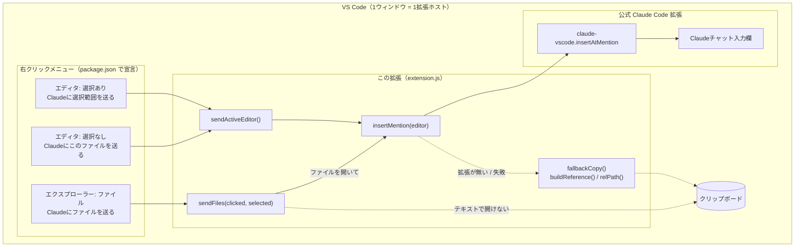
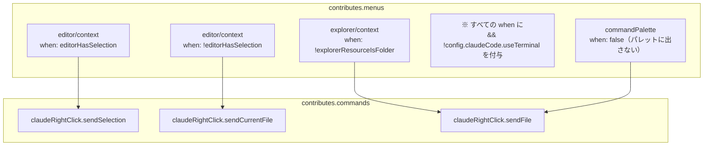
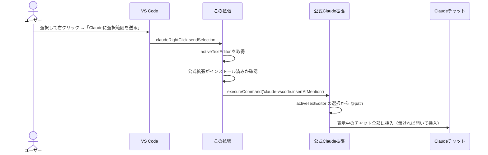
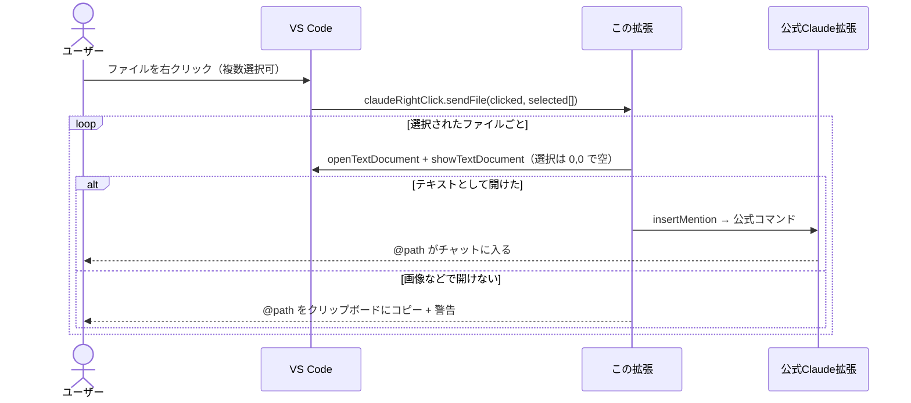
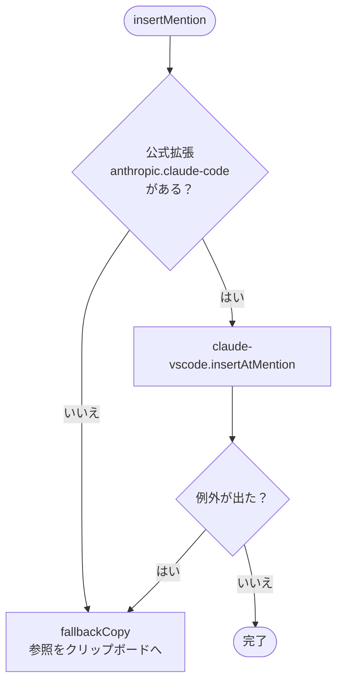
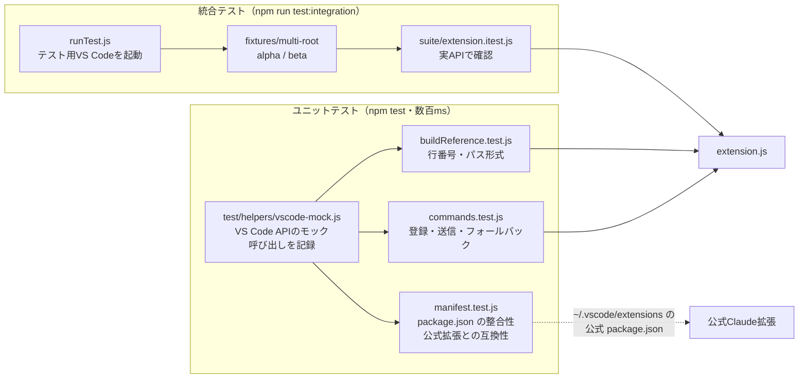

# Claude Right Click — アーキテクチャ

右クリックメニューから、公式 Claude Code 拡張の「Insert @-Mention Reference」（Alt+K）を呼び出すだけの薄いラッパー拡張。
自前でClaudeと通信はせず、**入口（メニュー）を足して、処理は公式拡張に委ねる**のが基本方針。

- バージョン: 0.0.1
- 対象モード: VS Code のClaudeパネル版のみ（`claudeCode.useTerminal` が true のときはメニューを出さない）
- 言語: 素の JavaScript（ビルド不要）
- 対象: VS Code 1.94 以上、公式拡張 `anthropic.claude-code`（v2.1.317 で確認）

---

## 1. 全体構成



**ポイント**

- メニュー項目・表示条件は `package.json` の `contributes.menus` だけで決まる（コードは書いていない）。
- 実際に `@file#5-10` を作ってチャットに入れるのは公式拡張。この拡張はそのコマンドを呼ぶだけ。
- 公式拡張が使えない時だけ、自前で参照文字列を作ってクリップボードに入れる。

---

## 2. ファイル構成

| ファイル | 役割 |
|---|---|
| `package.json` | 拡張のマニフェスト。コマンド3つと右クリックメニューを宣言 |
| `extension.js` | 本体（約95行）。コマンドの登録と処理。テスト用に `_internal` で内部関数も公開 |
| `README.md` | 使い方（GitHub のトップに表示される） |
| `docs/ARCHITECTURE.md` | このファイル |
| `LICENSE` | MIT ライセンス |
| `.vscodeignore` | vsix に入れないファイルの指定（`docs/`・`test/` など） |
| `.gitignore` | git に入れないファイルの指定（`node_modules/`・`*.vsix` など） |
| `test/` | テスト一式（→ 10章）。vsix には含めない |

vsix はリポジトリに入れない。配るときは `npm run package` で作り、GitHub の Releases に添付する。

---

## 3. package.json（宣言部分）



- `when` 条件で、選択の有無により**どちらか片方だけ**がメニューに出る。
- すべての `when` に `!config.claudeCode.useTerminal` を付けているので、ターミナル版の設定ではメニュー・パレットに出ない（公式拡張のコマンドパレット設定と同じ条件）。
- `sendFile` はエクスプローラーで選んだURIを引数に受け取る前提なので、コマンドパレットからは隠している。
- `activationEvents` は書いていない。VS Code 1.74 以降はコマンド実行時に自動で有効化される。

---

## 4. extension.js の関数

| 関数 | 行 | 役割 |
|---|---|---|
| `activate(context)` | 78 | 3つのコマンドを登録（`sendSelection` と `sendCurrentFile` は同じ処理） |
| `sendActiveEditor()` | 47 | エディタからの右クリック。アクティブなエディタを `insertMention` に渡す |
| `sendFiles(clicked, selected)` | 57 | エクスプローラーからの右クリック。複数選択に対応。ファイルを開き、選択を空にしてから `insertMention` |
| `insertMention(editor)` | 35 | 公式拡張の有無を確認 → 公式コマンドを実行。失敗したらフォールバック |
| `fallbackCopy(editor, reason)` | 29 | 参照を作ってクリップボードにコピーし、警告を出す |
| `buildReference(editor)` | 18 | `@path`, `@path#8`, `@path#5-10` を作る |
| `relPath(uri)` | 13 | `asRelativePath` で公式と同じ形式のパスにする |

---

## 5. 処理の流れ

### 5-1. エディタで選択して右クリック



### 5-2. エクスプローラーでファイルを右クリック



ファイルを一度エディタで開くのは、公式コマンドが「アクティブなエディタ」からしか参照を作れないため（URIを引数で渡す口がない）。

### 5-3. フォールバックの判断



---

## 6. 参照文字列の形式

公式拡張（`Fx` / `RAe` 関数）の実装に合わせている。

| 状況 | 例 |
|---|---|
| 選択なし | `@src/app.ts` |
| 1行 | `@src/app.ts#8` |
| 複数行 | `@src/app.ts#5-10` |
| マルチルート | `@beta/src/app.ts`（先頭にフォルダ名） |
| ワークスペース外 | 絶対パス |

公式との違い（フォールバック時のみ）: 次の行の先頭で選択が終わっている場合、この拡張は最終行を1行減らす（公式は減らさない）。

---

## 7. 設計上の判断

- **公式コマンドに委ねる**: 参照の形式やチャットへの挿入方法を公式と完全に一致させられ、コードも短い。
- **コマンドIDは公開APIではない**: 公式拡張の更新で名前が変わると動かなくなる。その場合は `extension.js` 冒頭の `CLAUDE_CMD` を書き換える（キーボードショートカット画面で「Insert @-Mention」を検索 → 右クリック →「コマンドIDをコピー」）。
- **失敗しても無駄にしない**: 送れない時はクリップボードにコピーし、手で貼れるようにしている。

---

## 8. 既知の制約（実験で分かったこと）

| 項目 | 内容 | この拡張で対処できるか |
|---|---|---|
| 送り先 | 表示中のClaudeチャットが複数あると全部に入る | できない（公式の動作） |
| 複数ウィンドウ | ウィンドウごとに独立して動く | 対処不要 |
| ターミナル版 | 対象外。`useTerminal` が true の時はメニューを出さない | 対象外（意図的） |
| 同じ名前のフォルダ | マルチルートで同名フォルダがあると参照が区別できない → `.code-workspace` の `"name"` で回避 | ワークスペース側で対処 |
| 設定のスコープ | `claudeCode.*` は全て window / application / machine スコープ。マルチルートではフォルダの settings.json に書いても効かない | できない（VS Code の仕様） |
| リモート（WSL/SSH） | リモート側にも拡張のインストールが必要な場合がある | インストールで対処 |

---

## 9. 開発・ビルド

```bash
# 動作確認（このフォルダを VS Code で開いて）
F5   # 拡張開発ホストが起動する

# パッケージ化
npm run package   # = vsce package（package.json の repository を使う）

# 更新時は package.json の version を上げてから再パッケージ → VSIX から再インストール
```

---

## 10. テスト



### 構成

| ファイル | 内容 | 件数 |
|---|---|---|
| `test/helpers/vscode-mock.js` | VS Code API のモック。`asRelativePath` のマルチルート挙動、`Selection` の正規化、バイナリで開けないファイルなどを再現。`setup()` でモック＋拡張＋activate を一度に用意 | — |
| `test/unit/buildReference.test.js` | 行番号（1行・複数行・次行先頭で終わる・逆方向選択）、パス形式（単一・マルチルート・別の場所・入れ子・ワークスペース外） | 15 |
| `test/unit/commands.test.js` | コマンド登録と dispose、送信の分岐（成功・拡張なし・例外・reject）、エクスプローラー（単一・複数・空・引数なし・バイナリ混在） | 20 |
| `test/unit/manifest.test.js` | package.json の基本項目、宣言とコードの一致、メニューの `when` 条件、公式拡張にコマンドが存在するか | 14 |
| `test/run-unit.js` | ユニットテストの実行スクリプト（Windows / 古いNodeでも動くようにファイルを列挙） | — |
| `test/integration/runTest.js` | `@vscode/test-electron` でテスト用VS Codeを起動（他の拡張は無効） | — |
| `test/integration/suite/extension.itest.js` | 実VS Code上でマルチルートのパス、選択の扱い、エクスプローラー送信、バイナリファイル | 14 |
| `test/fixtures/multi-root/` | 統合テスト用ワークスペース（同名の `app.js` を持つ alpha / beta、バイナリファイル） | — |

### 実行方法

```bash
npm install                 # 初回のみ（テスト用の依存を入れる）
npm test                    # ユニットテスト
npm run test:spec           # ユニットテスト（結果を一覧表示）
npm run test:integration    # 統合テスト（初回はテスト用VS Codeをダウンロード）
```

### ポイント

- **ユニットテストは依存なし**: Node 標準の `node:test` を使うので `npm install` なしでも `npm test` が動く。
- **公式拡張の更新を検知**: `manifest.test.js` は `~/.vscode/extensions/anthropic.claude-code-*` の package.json を読み、呼んでいる `claude-vscode.insertAtMention` がまだ存在するかを確認する。公式拡張を更新した後に `npm test` を流せば、コマンド名の変更に気づける。見つからない環境ではスキップ（`CLAUDE_EXT_DIR` で場所を指定可能）。
- **統合テストは公式拡張なし**: テスト用VS Codeでは他の拡張を無効にするため、送信結果はクリップボードで確認する（フォールバック経路）。公式拡張のチャット欄に入るところは自動テストできないので、手動で確認する。
- **テストの効き目を確認済み**: わざとバグを入れて（行番号の0始まり、コマンドID誤り、例外の握りつぶし、選択リセット削除、複数選択の無視、フォルダ名の欠落、メニュー条件の欠落 など9種類）すべて検出できることを確認した。

