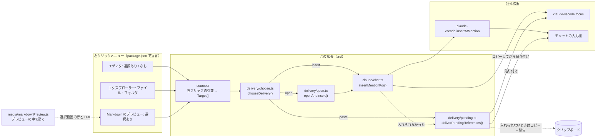
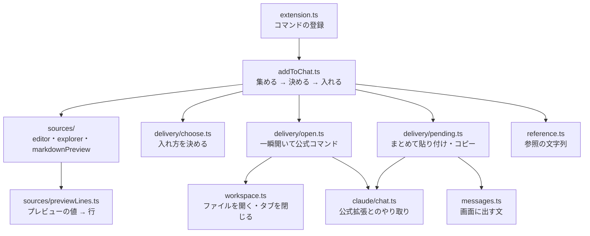
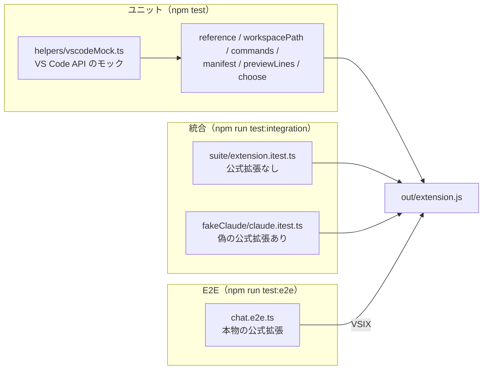

# Refs to Chat のアーキテクチャ

右クリックメニューから、公式の Claude Code 拡張（以下「公式拡張」）のコマンドを呼び、参照をチャットに入れる小さな拡張。
公式のコマンドで扱えないもの（フォルダなど）は、参照をチャットの入力欄に貼り付けて入れる。
自前で Claude と通信はしない。右クリックのメニューを足し、参照を作ってチャットに入れる処理は、できるだけ公式拡張に任せる。

- 対象: VS Code 1.94 以上、公式拡張 `anthropic.claude-code` の Claude パネル版（`claudeCode.useTerminal` が true のときはメニューを出さない）
- 言語: TypeScript（本体もテストも `src/` に置き、`tsc` で `out/` にコンパイル）。Markdown のプレビューに読み込むスクリプトだけは JavaScript（`media/`）

開発のコマンドとリリースの手順は [DEVELOPMENT.md](DEVELOPMENT.md)、テストの考え方は [TEST_POLICY.md](TEST_POLICY.md) にある。

---

## 1. 全体構成



右クリックの入口は 3 つ（エディタ・エクスプローラー・Markdown のプレビュー）。
入口（`sources/`）は、右クリックで渡された引数を、共通の形 `Target` の一覧に直すだけ。チャットへの入れ方は、`delivery/choose.ts` の `chooseDelivery` が 1 か所で決める（→ 5-2）。

参照をチャットに入れる方法は 2 つある。

- 公式コマンドで入れる。エディタからの追加と、設定 `keep` のときのエクスプローラーのファイル・プレビューの行。参照を作るのは公式拡張で、この拡張はコマンドを呼ぶだけ（→ 5-5）。エディタ以外は、ファイルを一瞬開いてから呼ぶ（→ 5-3）
- 貼り付けで入れる。フォルダ、テキストとして開けないファイル、設定 `use`（初期設定）のときのエクスプローラーのファイル・プレビューの行。参照をクリップボードにコピーし、チャットの入力欄にフォーカスしてから、VS Code 標準の貼り付けを呼ぶ（→ 5-6）

どちらでも入れられないときは、参照をクリップボードにコピーして警告を出す（→ 5-7）。
なぜこの作りにしたかは 7 章にある。

---

## 2. ファイル構成

| ファイル | 役割 |
|---|---|
| `package.json` | 拡張のマニフェスト。コマンド、右クリックメニュー、設定、プレビューに読み込むスクリプトを宣言する（→ 3 章） |
| `src/` | 本体（→ 4 章）。`src/test/` はテスト（→ 10 章） |
| `media/markdownPreview.js` | 組み込みの Markdown プレビューに読み込むスクリプト。選択範囲を、元のファイルの行が分かる値にする（→ 5-4） |
| `out/` | `src/` のコンパイル結果。git には入れない |
| `README.md`・`CHANGELOG.md` | 使い方と変更履歴。リリースの説明文は CHANGELOG から作る |
| `docs/` | このファイル、開発の手順（DEVELOPMENT）、テスト方針（TEST_POLICY）、手動テストの手順（MANUAL_TEST） |
| `.github/workflows/` | `ci.yml`（PR と main への push で確かめる）、`release.yml`（タグの push でリリースする）（→ 9 章） |
| `.vscodeignore` | VSIX に入れないもの。VSIX に入るのは `out/*.js`・`media/`・`package.json`・README・CHANGELOG・LICENSE だけ |

ほかに、`tsconfig.json`（TypeScript 7、`strict`）、`.oxlintrc.json`（リンター）、`.node-version`（Node 26）、`.vscode/`（`F5` の設定）、`.github/dependabot.yml` がある。

---

## 3. package.json（宣言）

- エディタとエクスプローラーのメニュー項目と表示条件は、`contributes.menus` だけで決まる（コードは書いていない）
- エディタの右クリックは、選択の有無で「選択範囲を…」と「このファイルを…」のどちらか片方だけを出す（`editorHasSelection`）
- Markdown のプレビューの右クリックは `webview/context` に宣言する。条件は次の 3 つ
  - プレビューの `webviewId` が `vscode.markdown.preview.editor`（Ctrl+Shift+V で開いたもの）か `markdown.preview`（コマンドパレットの「Open Preview」と「Open Preview to the Side」で開いたもの）。開き方で ID が違うので、両方を書く
  - プレビューのスクリプトが入れるキー `refsToChatPreviewSelection` がある（文章を選んで右クリックしたときだけ入る → 5-4）
  - 設定 `refsToChat.markdownPreview` が `true`（初期設定）。この機能を使わない人が、メニューから消せるようにしている
- 対象は VS Code に組み込みの Markdown プレビューだけ。ほかの拡張のプレビュー（Markdown Preview Enhanced など）は、`webviewId` も中身の作りも違うので、メニューに出ない
- `markdown.previewScripts` で `media/markdownPreview.js` を組み込みのプレビューに読み込む。設定で止めることはできない（読み込まれても、右クリックのときに属性を 1 つ付けるだけ）
- すべての `when` に `!config.claudeCode.useTerminal` を付けている。ターミナル版の設定では出さない（公式拡張と同じ条件）
- エディタの 2 つのコマンドは、テキストのファイルが前面にあるときだけコマンドパレットに出す（`editorLangId`）。`editorIsOpen` だと、チャットをエディタのタブで開いているだけで出てしまうため
- `sendFile` はエクスプローラーで選んだ URI を、`sendPreviewSelection` はプレビューの値を受け取る前提なので、コマンドパレットには出さない
- 設定は 3 つ。`refsToChat.explorerClipboard` と `refsToChat.previewClipboard` は、どちらも `use`（初期設定）と `keep` で、知らない値は `use` として扱う。`refsToChat.markdownPreview`（真偽値、初期設定は `true`）は、メニューの `when` で使うだけで、コードからは読まない
- `capabilities.untrustedWorkspaces.supported: false` で、制限モードでは動かさない
- `extensionKind: ["workspace"]` で、Remote ではリモート側でだけ動かす（→ 7 章・8 章）
- `activationEvents` は書いていない（VS Code 1.74 以降は、コマンドを実行したときに自動で有効になる）

---

## 4. src/ の構成

状態を持たない処理を順に呼ぶだけなので、クラスは使わず、型と関数で書いている。
「どこから」（入口）と「どうやって」（入れ方）を分けている。



| ファイル | 役目 |
|---|---|
| `extension.ts` | 4 つのコマンドを、入口ごとに `addToChat(入口)` で登録する（`sendSelection` と `sendCurrentFile` は同じ入口） |
| `addToChat.ts` | 右クリックのコマンドの本体。入口が集めた `Target` を、`chooseDelivery` が決めた入れ方で入れ、残りを `deliverPendingReferences` に渡す（→ 5-1） |
| `target.ts` | `Target` の型。`editor`（前面のエディタ）・`file`・`folder`・`lines`（ファイルの行の範囲）の 4 種類 |
| `sources/source.ts` | 入口の型。`collect`（引数 → `Target` の一覧か、案内の文）と `clipboard`（その入口の設定） |
| `sources/editor.ts`・`explorer.ts`・`markdownPreview.ts` | 3 つの入口 |
| `sources/previewLines.ts` | プレビューの値を、元のファイルの行に直す計算（→ 5-4） |
| `delivery/choose.ts` | `Target` × 設定 → 入れ方（`insert`・`open`・`paste`）。組み合わせはここだけで決める（→ 5-2） |
| `delivery/open.ts` | ファイルを一瞬開いて（行があれば選んで）、公式コマンドで入れる（→ 5-3） |
| `delivery/pending.ts` | 後回しにした参照を、まとめて貼り付けかコピーで届ける（→ 5-7）。貼り付けるかコピーするかは、ここだけで決める |
| `claude/chat.ts` | 公式拡張とのやり取り。公式コマンドで入れる（→ 5-5）、チャットに貼り付ける（→ 5-6） |
| `workspace.ts` | 公式と同じ形式のパス、フォルダの判定、ファイルの行を読む、ファイルを開く・タブを閉じる |
| `reference.ts` | 参照の文字列を作る（→ 6 章） |
| `config.ts` | 2 つの設定を読む。知らない値は `use` として扱う |
| `constants.ts` | コマンド ID、公式拡張の ID とコマンド、待ち時間（`FOCUS_WAIT_MS` 800ms、`PASTE_CHECK_MS` 150ms）、設定の名前 |
| `messages.ts` | 画面に出す文。テストも同じ定数と比べるので、文を変えてもテストを直さなくてよい |

`constants.ts`・`messages.ts`・`reference.ts`・`sources/previewLines.ts`・`delivery/choose.ts` は vscode に依存しないので、テストからモックなしで読み込める。
関数ごとのくわしい決まりは、コードのコメントに書いている。

### 名前の付け方と、機能を足すときの置き場所

| 動詞 | 意味 | 例 |
| --- | --- | --- |
| add | この拡張のコマンド（ユーザーから見た「チャットに追加」） | `addToChat` |
| collect | 入口が、右クリックの引数から `Target` を集める | `editorSource.collect` |
| choose | `Target` の入れ方を決める | `chooseDelivery` |
| insert | 公式コマンドでチャットに入れる | `insertMentionFor`、`openAndInsert` |
| paste | クリップボードからチャットに貼り付ける | `pasteClipboardIntoChat` |
| deliver | 後回しにした参照を、まとめて貼り付けかコピーで届ける | `deliverPendingReferences` |

`COMMANDS` のキーが `sendXxx` なのは、公開済みのコマンド ID（`refsToChat.sendSelection` など）に合わせているため。

- 新しい右クリックの入口 → `package.json` に宣言、`constants.ts` に ID、`sources/` に入口を 1 つ、`extension.ts` で登録。新しい種類の `Target` が要るときは `target.ts` と `chooseDelivery`
- 入れ方の組み合わせを変える → `delivery/choose.ts` の `chooseDelivery`
- 新しい入れ方 → `delivery/` に処理を足し、`Delivery` の型と `chooseDelivery`、`addToChat.ts` の `add` に 1 つずつ足す
- 公式拡張の別のコマンドを使う → `constants.ts` の `CLAUDE` と `claude/chat.ts`
- 参照の形式 → `reference.ts`
- 画面に出す文 → `messages.ts`
- 貼り付けるかコピーするかの条件 → `delivery/pending.ts` の `deliverPendingReferences`
- 設定を足す → `package.json` の `contributes.configuration`、`constants.ts` の `SETTINGS`、`config.ts`
- ファイルを開いて入れる流れ → `delivery/open.ts` と `workspace.ts` の `openForMention`
- 組み込みのプレビューの作りに合わせる → `media/markdownPreview.js`（頼っている部分はここだけ）

---

## 5. 処理の流れ

### 5-1. 共通の流れ（`addToChat`）

3 つの入口とも、同じ流れで動く。

```text
① 今のエディタグループを覚える（チャットを開くと変わるため）
② 入口が Target を集める
     └─ ない → 案内を出して終わり
          エディタ「開いているファイルがありません」、エクスプローラー「追加するファイルやフォルダがありません」
          プレビュー「プレビューで選んだところを、元のファイルの行に直せませんでした」
③ 入口の設定を 1 回だけ読む（途中で変わっても、同じ入れ方で最後まで送る）
④ Target ごとに、chooseDelivery で入れ方を決めて入れる（5-2）
     ├─ insert → 5-5 で公式コマンドで入れる
     ├─ open   → 5-3 でファイルを一瞬開き、5-5 で入れる
     │            └─ 開けない（画像など）→ 後回し（paste）
     └─ paste  → 後回し（paste）
     入れられなかったもの → 後回し（notInstalled / failed）
⑤ 後回しの分をまとめて、5-7 の届ける処理へ
```

入口ごとの Target は次のとおり。

| 入口 | Target |
|---|---|
| エディタ | `editor`（前面のエディタ。選択範囲は公式コマンドがそのまま読む） |
| エクスプローラー | 選んだ順に、フォルダは `folder`、それ以外は `file` |
| Markdown のプレビュー | `lines`（元のファイルと行の範囲。→ 5-4） |

### 5-2. 入れ方の決め方（`chooseDelivery`）

| Target | 設定 use（初期） | 設定 keep |
|---|---|---|
| `editor` | 公式コマンド（insert） | 公式コマンド（insert） |
| `folder` | 貼り付け（paste） | 貼り付け（paste） |
| `file`（エクスプローラー） | 貼り付け（paste） | 一瞬開いて公式コマンド（open。右クリックしたときのグループに開く） |
| `lines`（プレビュー） | 貼り付け（paste） | 一瞬開いて公式コマンド（open。元のファイルを表示しているグループがあれば、そのエディタを使う） |

エディタは設定に関係なく公式コマンドで入れる（`editorSource.clipboard` は `keep` を返す）。
エクスプローラーのファイルを右クリックしたときのグループに開くのは、2 つ目以降のファイルも同じグループにそろえるため。プレビューの行は 1 つだけなので、横に表示しているエディタを優先して、新しいタブを作らないようにしている。

### 5-3. ファイルを一瞬開く（`openForMention`）

公式コマンドは「アクティブなエディタ」からしか参照を作れないので、設定 `keep` のときはファイルを一度開く。開いたタブは次のように扱う。

- 開くのは、5-2 で決めたグループ
- そのグループにもともとタブがなければ、入れたあとで閉じる。閉じるときは、グループを取り直してからタブを探す（VS Code 1.100 では、開いたときに受け取ったグループに、あとから増えたタブが入らないため）
- もともとタブがあれば残し、カーソルの位置や選択範囲も元に戻す。タブが裏に回っていたときは、前面にあったタブを前面に戻す
  - Markdown のプレビュー（Webview のタブ）は API で前面に出せないので、そのグループにフォーカスを移してから、VS Code 標準の「グループ内で直前に使ったエディタを開く」（`workbench.action.openPreviousRecentlyUsedEditorInGroup`）を呼ぶ
- タブがあるかは、ドキュメント自身の URI で調べる（Windows でパスの大文字・小文字が違っても正しく判定できる）
- プレビュー（斜体のタブ）では開かない。ユーザーがプレビューで開いていた別のファイルのタブを、置き換えて消してしまうため
- 公式コマンドを呼ぶ直前に、選択を整える。エクスプローラーのファイルは、今のカーソル位置の空の選択にする（選択範囲が参照に入らないように）。プレビューの行は、最初の行の先頭から最後の行の末尾までを選ぶ

### 5-4. プレビューの選択範囲を行に直す

組み込みの Markdown プレビューは Webview なので、ほかの拡張は選択範囲を読めない。そこで、プレビューにスクリプト（`media/markdownPreview.js`）を読み込み、右クリックのたびに値を作る。

```text
プレビューの中（media/markdownPreview.js）
  右クリック（contextmenu をキャプチャで受け取る。VS Code が値を読むより先に動く）
  ① body の data-vscode-context から、前の値を消す（途中で失敗しても、古い値でメニューが動かないように）
  ② 選択範囲の始まりと終わりを、それぞれ「ブロックの data-line + ブロックの中でその前にある改行の数」で表す
  ③ 元のファイルの URI（meta#vscode-markdown-preview-data の data-settings の source）と一緒に、
     data-vscode-context の refsToChatPreviewSelection に入れる
VS Code
  data-vscode-context の値でメニューの when を決め、コマンドの引数に渡す
この拡張（sources/markdownPreview.ts・previewLines.ts）
  ④ 引数の形を確かめる（parsePreviewSelection）
  ⑤ 元のファイルを読み（タブは開かない）、行の範囲に直す（previewLineRange）
     フェンス（``` か ~~~）のコードブロックは、data-line がフェンスの行なので 1 行下げる
     プレビューの行がファイルの外なら、案内を出して終わり
```

段落やコードブロックの中の改行は、プレビューでも改行の文字のまま残っている。そのため、ブロックの途中を選んでも、行単位で分かる。表やリストの要素のすぐ下にある改行は、HTML を整えるためのものなので数えない。

行の精度（VS Code 1.145 で確かめた）は次のとおり。

| 選んだところ | 精度 |
|---|---|
| 段落・見出し・リストの項目（続きの行や入れ子も） | 行単位 |
| 表 | 行単位（表の行ごとに data-line がある） |
| コードブロック | 中身の行単位 |
| 引用 | 行単位 |
| HTML ブロック | ブロックの先頭の行（data-line は中身のない目印の要素に付き、本文はその後ろに並ぶので、前にある data-line を使う） |
| フロントマター | 1 行目（data-line がない） |
| 図（Mermaid）・数式 | 確かめていない |

### 5-5. 公式コマンドで入れる（`insertMentionFor`）

```text
公式拡張がある見込みは？（手元にある、またはリモートにつないでいる。mayHaveClaude）
  ├─ ない → 理由「notInstalled」
  └─ ある
       ① チャットを開く（claude-vscode.focus。失敗しても続ける）
       ② 元のエディタを前面に戻す（選択範囲はそのまま。前面ならしない）
       ③ 公式コマンド（claude-vscode.insertAtMention）を呼ぶ
            ├─ 成功 → 完了（通知なし、クリップボードは変えない）
            └─ 失敗 → 公式コマンドがどこかに登録されている？（isClaudeMissing）
                     ├─ いない → 理由「notInstalled」
                     └─ いる   → 理由「failed」
```

### 5-6. 貼り付け処理（`pasteClipboardIntoChat`）

```text
0. ファイルの変更を見張り始める
1. クリップボードに「参照 + 空白」を書く（delivery/pending.ts の pasteIntoChat）
2. チャットにフォーカスを移す（claude-vscode.focus）── 失敗 →「貼り付けられなかった」
3. 800ms 待つ（FOCUS_WAIT_MS）
4. 標準の貼り付け（フォーカスがある場所に入る）── 失敗 →「貼り付けられなかった」
5. 150ms 待つ（PASTE_CHECK_MS）
6. そのあいだに、どこかのファイルに同じ文字が入った？
     ├─ いいえ →「貼り付けた」とみなす（本当にチャットに入ったかは分からない）
     └─ はい → 次の 3 つをすべて満たす？
              ・文字が入ったのは 1 つのファイルだけ
              ・そのファイルが、前面のエディタのもの
              ・入ったあと、そのファイルがほかに変わっていない（版が入った直後のまま）
                ├─ 満たす → undo で取り消し、150ms 待つ
                │            ├─ 版が進んだ（取り消せた）→「貼り付けられなかった」
                │            └─ 進まない              →「ファイルに残った」
                └─ 満たさない → 取り消さない →「ファイルに残った」
```

4 の貼り付けは、その瞬間にキーボードのフォーカスがある場所に入る。
2 でフォーカスがチャットに移りきらないと、前に使っていたエディタに参照の文字が書き込まれる。6 はそれを取り消すためのもの。
`undo` は場所を指定できず、条件を満たさないときに使うとユーザーの操作を取り消してしまうので、使わずに警告で知らせる。

### 5-7. 届ける処理（`deliverPendingReferences`）

```text
① 名前に改行などの特別な文字があるもの → 取り除き、警告「…N 件あったので、追加もコピーもしませんでした」
   （残りがなければ、ここで終わり）
② 公式拡張がある見込みがない → まとめてコピー + 警告「見つからないか、動いていません」
③ notInstalled / failed が 1 つでもある → まとめてコピー + 警告（その理由）
④ 残りが貼り付けで入れるもの（paste）だけ → 5-6 の貼り付け処理
     ├─ 貼り付けた → 完了（通知なし。クリップボードには「参照 + 空白」が残る）
     ├─ 貼り付けられなかった → まとめてコピー + 警告
     │    （公式拡張がどこにもなければ「見つからないか…」、あれば「貼り付けられませんでした」）
     └─ ファイルに残った → まとめてコピー + 警告「…開いているファイルに入ったかもしれません（Ctrl+Z で戻してください）」
```

「まとめてコピー」は、参照を空白でつないで 1 回だけコピーし、警告も 1 回だけ出す（末尾に空白は付けない）。

### 5-8. ケースごとの結果

| # | ケース | チャット | クリップボード | 表示 |
| --- | --- | --- | --- | --- |
| 1 | エディタから（正常） | 入る | 変えない | なし |
| 2 | エクスプローラーのファイル・設定 use（正常） | 入る | 参照 + 空白 | なし |
| 3 | エクスプローラーのファイル・設定 keep（正常） | 入る | 変えない | なし |
| 4 | フォルダ・画像など（正常） | 入る | 参照 + 空白 | なし |
| 4-2 | Markdown のプレビュー・設定 use（正常） | 入る | 参照 + 空白 | なし |
| 4-3 | Markdown のプレビュー・設定 keep（正常） | 入る | 変えない | なし |
| 4-4 | プレビューの行が元のファイルに収まらない（プレビューが古いなど） | 入らない | 変えない | 案内「…元のファイルの行に直せませんでした」 |
| 5 | 公式拡張がない（手元） | 入らない | 参照 | 警告「見つからないか、動いていません」 |
| 6 | 公式拡張がない（リモート） | 入らない（呼んでみて失敗） | 参照 | 警告「見つからないか、動いていません」 |
| 7 | 公式コマンドが失敗 | 入らない | 参照 | 警告「追加できませんでした」 |
| 8 | チャットにフォーカスを移せない | 入らない | 参照 | 警告「貼り付けられませんでした」 |
| 9 | フォーカスが移らず、前面のエディタに入った | 入らない（取り消す） | 参照 | 警告「貼り付けられませんでした」 |
| 9-2 | 9 で、取り消しの条件を満たさない（ほかのファイルに入った、入ったあとに変わった、など） | 入らない（ファイルに文字が残る） | 参照 | 警告「…ファイルに入ったかもしれません（Ctrl+Z で戻してください）」 |
| 10 | ログインの画面が出ているなど | 入らない（見分けられない） | 参照 + 空白 | なし |
| 11 | フォーカスが移らず、ターミナルに入った | 入らない（見分けられない。改行は入らない） | 参照 + 空白 | なし |
| 12 | 名前に改行などの特別な文字 | 入らない | 変えない | 警告「…N 件…追加もコピーもしませんでした」 |
| 13 | 一部だけ失敗（keep でファイルは失敗、フォルダもある） | 成功した分だけ入る | 残りをまとめて | 警告 1 回 |
| 14 | チャットの起動に 15 秒以上かかる | 入らないことがある（公式拡張があきらめる） | 変えない | なし |

10・11・14 は見分ける方法がないので、README に書いている。

---

## 6. 参照文字列の形式

この拡張が自分で参照を作るのは、貼り付けやコピーをするときだけ。公式拡張のコマンドで入れた文字列と比べ、同じ形式にしている。

| 状況 | 例 |
|---|---|
| 選択なし | `@src/app.ts` |
| 1 行 | `@src/app.ts#8` |
| 複数行 | `@src/app.ts#5-10` |
| Markdown のプレビュー | `@docs/guide.md#12-18`（元のファイルの行。1 行なら `#12`） |
| マルチルート | `@beta/src/app.ts`（先頭にフォルダ名） |
| ワークスペース外 | 絶対パス |
| フォルダ | `@src/components/`（末尾に `/`） |
| 複数 | `@src/ @docs/ @logo.png`（空白でつなぐ） |

公式との違いが 1 つある。次の行の先頭で選択が終わっているとき、この拡張はその行を範囲に含めない（公式は含める）。

---

## 7. 設計上の判断

- 公式コマンドに任せる。参照の形式やチャットへの入れ方が公式と一致し、コードも短い。そのかわり、公式拡張の更新でコマンド名が変わると動かなくなる。そのときは `constants.ts` の `CLAUDE` を書き換える
- 先にチャットを開く。チャットが閉じていると、公式コマンドは起動を 15 秒待って、参照を入れずに諦める（失敗も返さない）。そこで、先に `claude-vscode.focus` で開く。チャットが開いているかを調べる API はないので、毎回開く
- 元のエディタを前面に戻す。チャットをエディタのタブで開いていると、フォーカスが移って「アクティブなエディタ」がなくなる。そこで、元のエディタを `showTextDocument` で前面に戻してから公式コマンドを呼ぶ。まだ前面にあるときは何もしない（左右に分けたエディタで、余計なタブを作らないため）
- フォルダなどは貼り付けで入れる。公式コマンドはファイルしか扱えないので、公開されている `claude-vscode.focus` と VS Code 標準の貼り付けを組み合わせる。欠点は、クリップボードを上書きすることと、本当に入ったかを確かめられないこと。そのため、貼り付けたときは通知を出さない
- `use` と `keep` を選べる。エクスプローラーのファイルは、初期設定では開かずに貼り付ける。`keep` はタブが一瞬ちらつき、`use` はクリップボードを上書きする。どちらを取るかを選べるようにした
- 貼り付ける前に 800ms 待つ。短いと、フォーカスがチャットに移りきる前の場所（エディタなど）に貼り付けてしまう。待たされても気にならない 1 秒未満で、なるべく長くした
- ファイルに貼り付けてしまったら、条件付きで取り消す。条件と流れは 5-6。ターミナルに入ったときは見分けられない
- 改行などを含む参照は、どこにも入れない。ファイル名に制御文字・見えない書式文字・行区切り（`\p{Cc}` `\p{Cf}` `\p{Zl}` `\p{Zp}`）があると、貼り付けもコピーもせず、件数だけ警告する。エディタやターミナルに入ると改行でコマンドとして動きかねず、文字の向きを変える文字で通知の表示を偽装されることもあるため
- 失敗しても無駄にしない。チャットに入れられないときは、クリップボードにコピーして、手で貼れるようにする
- 入口と入れ方を分ける。入口（`sources/`）は `Target` を集めるだけにし、入れ方の組み合わせは `chooseDelivery` の `switch` 1 か所で決める。入口や入れ方を足すときに、触る場所が 1 か所で済む。状態を持たないので、クラスではなく、判別可能なユニオン型（`Target`・`Delivery`）と関数で書く
- Markdown のプレビューは、初期設定では貼り付けで入れる。公式コマンドで入れるには元のファイルを一瞬開く必要があり、タブがちらつくため。クリップボードを書き換えたくない人のために、設定 `refsToChat.previewClipboard` の `keep` で公式コマンドに切り替えられる
- プレビューの行は、ブロックの `data-line` と、ブロックの中の改行の数から決める。`data-line` はスクロールを合わせるための、組み込みのプレビューの作りの一部で、公開された約束ではない。頼る部分は `media/markdownPreview.js` 1 か所にまとめ、変わったら E2E で気づけるようにしている（メニューが出なくなるか、行がずれる）
- 裏に回ったタブを前面に戻すのに、「グループ内で直前に使ったエディタを開く」を使う。Markdown のプレビュー（Webview のタブ）を前面に出す API がないため。そのグループにフォーカスが移る
- Remote ではリモート側でだけ動かす（`extensionKind: ["workspace"]`）。Markdown のプレビューを出す組み込みの Markdown 拡張はリモート側で動き、同じ側で動く拡張のスクリプトしか読み込まないため。0.1.0 までは手元の PC に入れるだけでも動くようにしていたが、それだとプレビューだけが動かず、どこまで動くかが分かりにくいので、リモート側に入れる形にそろえた
- `@types/node` は Node 20 に固定する。VS Code 1.94〜1.100 の拡張ホストは Node 20 で動く。本体が Node 20 にない API を使わないよう、型を合わせている

---

## 8. 既知の制約（実験で分かったこと）

| 項目 | 内容 | この拡張で対処できるか |
|---|---|---|
| 送り先 | 表示中の Claude のチャットが複数あると、すべてに入る | できない（公式の動作） |
| ターミナル版 | 対象外。`useTerminal` が true のときはメニューを出さない | 対象外（意図的） |
| 同じ名前のフォルダ | マルチルートで同名フォルダがあると、参照が区別できない | `.code-workspace` の `"name"` で回避 |
| 設定のスコープ | `claudeCode.*` は window / application / machine スコープ。マルチルートのフォルダの settings.json に書いても効かない | できない（VS Code の仕様） |
| リモート（WSL・SSH・Dev Containers） | この拡張はリモート側でだけ動く。手元の PC にだけ入れても、リモートのフォルダでは動かない（拡張機能ビューに、リモート側に入れるボタンが出る）。公式拡張が別の側で動いていると `getExtension` では見えないので、Remote では見えなくても公式コマンドを呼んでみる（5-5） | リモート側に入れてもらう（README に書いている。設定 `remote.defaultExtensionsIfInstalledLocally` で自動で入れられる） |
| チャットが起動しきっていない | 公式拡張は 15 秒待っても起動しないと、参照を入れずに諦める。失敗を返さないので、この拡張からは分からない | できない（README に書いている） |
| コマンドパレットの表示 | フォーカスがエクスプローラーやターミナルにあると、ファイルを開いていてもパレットに出ない | 仕様として受け入れる |
| 組み込みの Markdown プレビューの作り | `data-line` の付き方、`meta#vscode-markdown-preview-data` の `source`、段落の中の改行が残ることに頼っている。どれも公開された約束ではない | E2E で気づく（`media/markdownPreview.js` だけを直す） |
| プレビューの webviewId | 開き方で 2 種類ある（Ctrl+Shift+V: `vscode.markdown.preview.editor`、コマンドパレットの「Open Preview」「Open Preview to the Side」: `markdown.preview`） | 両方を `when` に書く |
| Ctrl+Shift+V のプレビュー | VS Code 1.145 では、タブを増やさず、そのエディタ自体をプレビューに切り替える。ファイルごとに覚え、次に開いたときもプレビューで開く | 仕様として受け入れる（E2E はテキストのエディタで開き直す） |
| プレビューの行の精度 | HTML ブロックは先頭の行、フロントマターは 1 行目になる。図（Mermaid）・数式は確かめていない（→ 5-4） | できない（ブロックの中の行が分からない） |
| エディタグループの情報が古くなる | VS Code 1.100 では、受け取った `TabGroup` の `tabs` に、あとから開いたタブが入らない（1.145 では入る） | 使うたびにグループを取り直す |
| ほかの拡張のプレビュー | Markdown Preview Enhanced など、組み込み以外のプレビューは対象外 | 対象外（意図的） |
| Dependabot の待ち期間 | `cooldown` は依存ごとに数えるので、TypeScript と `oxlint-tsgolint` が別々の PR で届き、CI が落ちることがある | 次の更新を待つか、手でそろえる |

---

## 9. 開発・ビルド

コマンドとリリースの手順は [DEVELOPMENT.md](DEVELOPMENT.md) にある。ここでは、しくみと理由だけを書く。

### GitHub Actions

- `ci.yml`: PR と main への push で、`npm ci`・リンター・ユニットテスト・VSIX 作成を確かめる。Dependabot の PR も、取り込む前に確かめられる
- `release.yml`: `v*` のタグを push すると動く
  - `package` ジョブ（読み取り権限のみ）: リンター・テスト・VSIX 作成
  - `release` ジョブ（書き込み権限あり、依存は入れない）: VSIX を Releases に添付し、出どころの証明（`actions/attest-build-provenance`）を付ける
  - 説明文は `CHANGELOG.md` の該当バージョンの項目から作る。項目がなければ失敗する。同じタグのリリースがあれば差し替える
  - 手動実行では Releases を作らず、VSIX を Actions の成果物に置くだけ

### リンター（Oxlint、`.oxlintrc.json`）

- TypeScript 7 に対応しているので Oxlint を使う。型情報を使うルールは `oxlint-tsgolint` が担当する（typescript-eslint は TypeScript 7 に対応していない）。TypeScript を上げるときは、`oxlint-tsgolint` も一緒に上げる
- ルールは、`correctness` の一式と、`typescript/no-floating-promises`（`await` 忘れ）、`typescript/no-misused-promises` だけにして、増やしすぎない
- `no-floating-promises` には `checkThenables: true` を付けている。VS Code の API は `Thenable` を返すので、付けないと見逃す。わざと待たない通知には `void` を付ける

### 安全のための設定

- 依存パッケージのインストールスクリプトは動かさない（`npm ci --ignore-scripts`）。外部の Action はコミットの SHA で固定する
- Dependabot は、新しいバージョンが出てから 7 日たってから提案する。`@types/vscode` は `engines.vscode` に合わせて手で上げる

---

## 10. テスト

テストの種類と、どれをいつ流すかは [TEST_POLICY.md](TEST_POLICY.md) にある。



| 場所 | 内容 |
|---|---|
| `src/test/unit/` | ユニットテスト。`commands.test.ts` が中心（モックの VS Code の上で、4 つのコマンドを動かす）で、細かい項目はテストの名前を見る。`manifest.test.ts` は package.json の宣言と、手元の公式拡張にコマンドがまだあるかを確かめる。`previewLines.test.ts`（プレビューの値 → 行）と `choose.test.ts`（入れ方の組み合わせ。5-2 の表と同じ）は、モックなしで確かめる |
| `src/test/helpers/vscodeMock.ts` | VS Code API のモック。`setup()` で、モックと拡張と activate を一度に用意する |
| `src/test/integration/` | 統合テスト。公式拡張なし（`suite/`）と、偽の公式拡張あり（`fakeClaude/`）の 2 回に分けて動かす |
| `src/test/fixtures/fake-claude-code/` | 偽の公式拡張。公開コマンドの `insertAtMention` と `focus` だけを用意し、呼ばれた瞬間の状態を記録する。チャットのかわりに、入力欄だけの Webview を開く |
| `src/test/fixtures/multi-root/` | 統合テストと E2E 用のワークスペース（同名の `app.js` を持つ alpha / beta、バイナリファイル、プレビュー用の `alpha/docs/guide.md`） |
| `src/test/e2e/` | E2E テスト。Playwright（`playwright-core` の `_electron`）で本物の VS Code を動かす。画面の部品の探し方は `selectors.ts` にまとめる |

### ポイント

- `npm test` は `out/` を消してからコンパイルし、`node --test` で動かす。統合テストは VS Code の中で `mocha` を使う
- 公式拡張を更新したら `npm test` を流す。`manifest.test.ts` が、呼んでいるコマンドがまだあるかを確かめる（`CLAUDE_EXT_DIR` で場所を指定できる）
- 偽の公式拡張のチャットは、本物と同じく Webview にしている。テキストのエディタにすると、テスト用のウィンドウにフォーカスがないとき、アクティブなエディタの情報が古いまま残り、結果が毎回変わったため
- テストが偶然通っていないかを、わざとバグを入れて確かめている（行番号のずれ、前面に戻す処理を消す、取り消しの条件を外す、など）
- わざとバグを入れるときは、コンパイルが通る形にする。E2E は VSIX を作り直してから動かすので、コンパイルに失敗すると古い VSIX のまま流れ、テストが通ってしまう（実際に起きた）

### E2E テストで守ること

本物のアカウントで動くので、次を守る。


- Enter を押さない。送信しない。候補はクリックで選ぶ。念のため、Enter だけでは送信しない設定（`claudeCode.useCtrlEnterToSend`）も入れる
- 入力欄に入ったことを確かめたら、毎回空にする。空にするのは Webview の中だけで行う（キー操作で消すと、フォーカスがエディタにあったときにファイルの中身を消してしまう。実際に起きた）
- テスト用のファイルは読み取り専用で開き、始める前と終わったあとに git の状態を確かめる。公式拡張が読む設定（`.claude/`、`.mcp.json`、`CLAUDE.md` など）が紛れ込んでいたら止める
- 普段の VS Code とは別のフォルダ（`.vscode-test/e2e/`）を使う。VS Code の版は、画面を調べた 1.145.2 に固定する（`VSCODE_TEST_VERSION` で変えられる）
- 版によって動きが違うことがある（例: 5-3 のタブを閉じる処理は、1.100 でだけ失敗していた）。版に関わる直しをしたときは、`VSCODE_TEST_VERSION=1.100.2` などでそのテストだけ流す。1.100.2 では、貼り付けで入れるテストの多くが落ちる（原因は調べていない）ので、全部は流さない
- 公式拡張の画面の部品は、実際の画面を開いて調べてから使う。チャットの入力欄は `[role="textbox"][aria-label="Message input"]`。ビルドごとに変わるクラス名は使わない
- 公式拡張のチャットがフォーカスを取り返すことがあるので、コマンドパレットや右クリックメニューが閉じたら、フォーカスを戻して開き直す
- 貼り付けた直後のチャットは、しばらくフォーカスを取り返し続ける。そのため、テストごとの準備の最初に、チャットが落ち着くまで待つ（`waitForChatToSettle`、1.5 秒）。この待ちを消すと、コマンドパレットが勝手に閉じて、テストが不安定になる
- テストごとの準備は、要るときだけ動かす。設定は値が変わるときだけ書き、右のサイドバーは開いているときだけ閉じ、タブは 1 つでもあるときだけ閉じる
- Markdown のプレビューの中身は、`#vscode-markdown-preview-data` があるフレームとして探す。選択はフレームの中で作り、その位置をマウスで右クリックする
